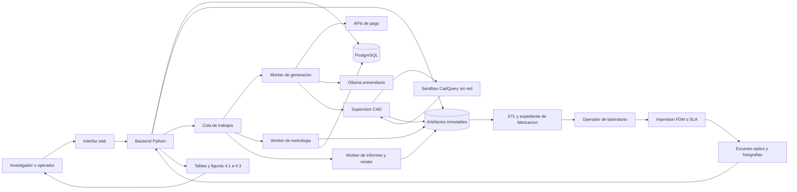
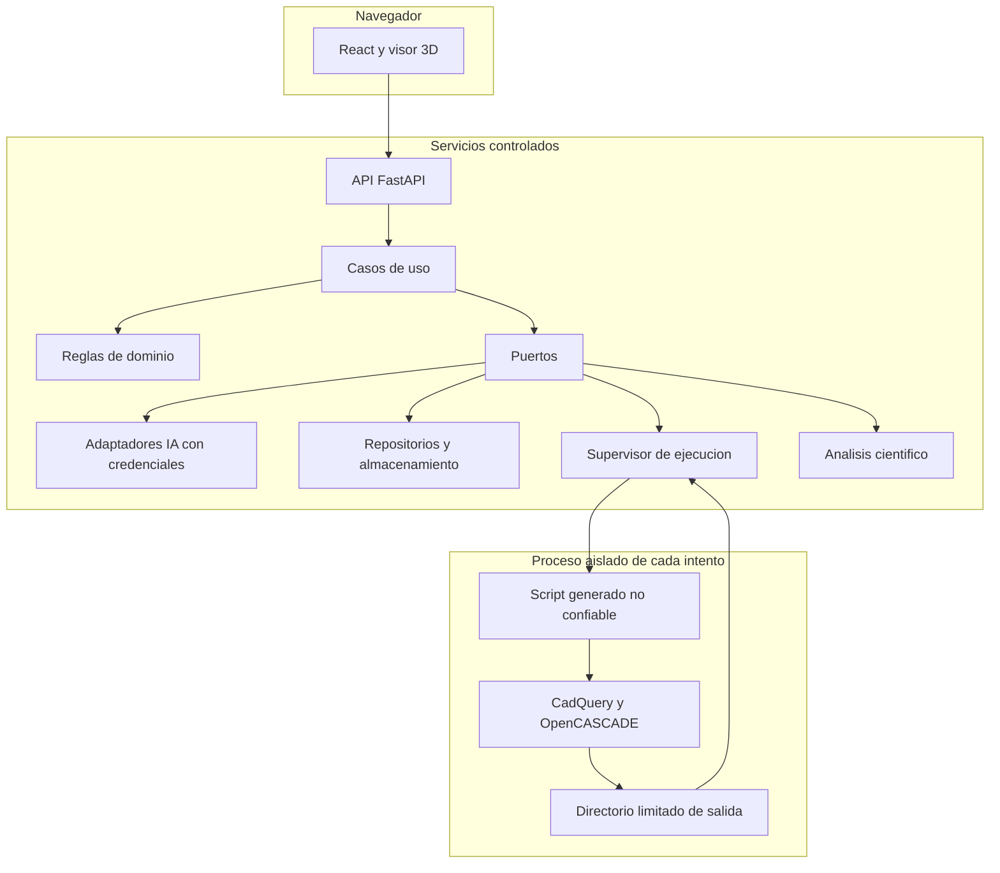
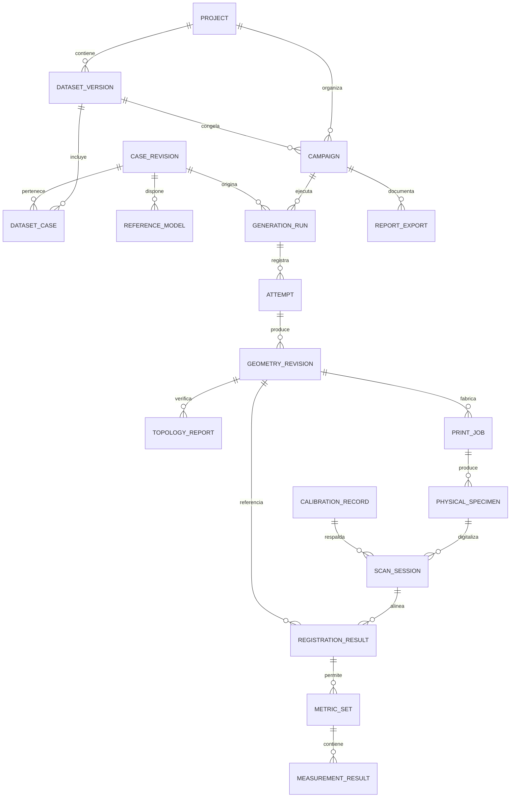
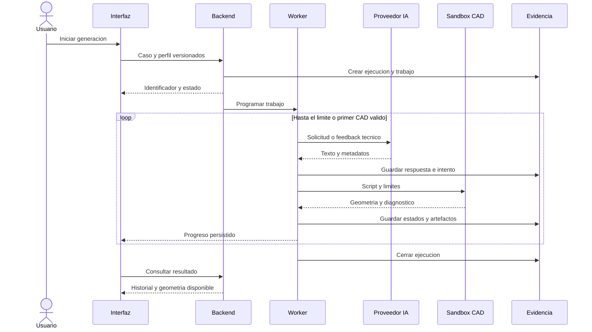
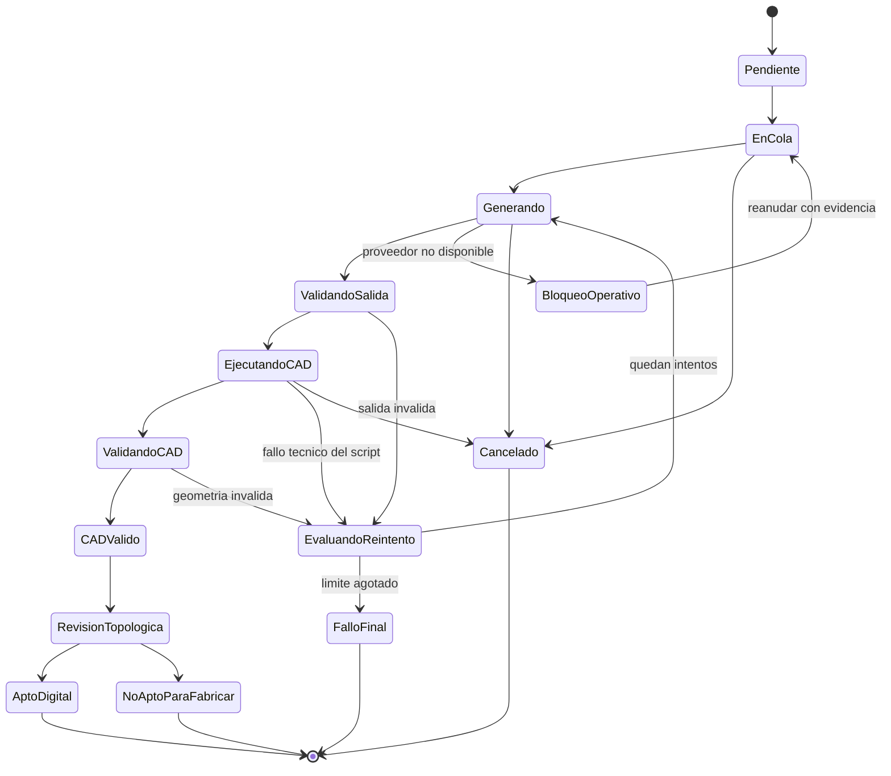
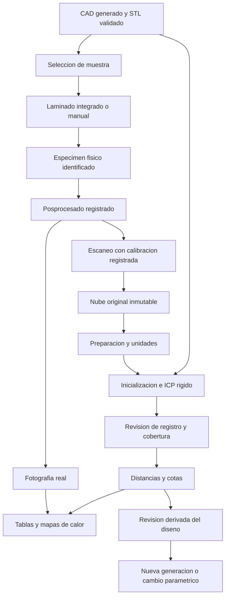
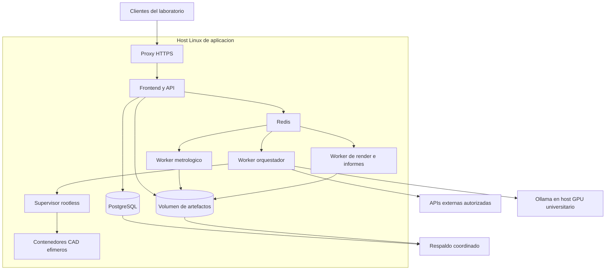
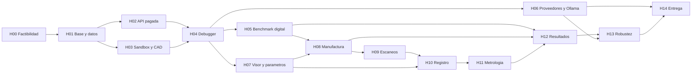

# Plan técnico de construcción de Agente-Ciel

**Sistema de generación CAD con IA, validación digital y metrología de piezas fabricadas**  
**Versión del plan:** 1.0  
**Fecha:** 1 de octubre de 2026  
**Destinatario:** agente de codificación Codex y responsable técnico del proyecto.  
**Alcance de este documento:** especificación de construcción del software; no contiene implementación ni ejemplos de código. Los bloques Mermaid representan diagramas del sistema.

**Navegación:**

- [Propósito y alcance](#1-propósito-y-resultado-esperado).
- [Decisiones y tecnologías](#3-decisiones-que-resuelven-ambigüedades-de-las-fuentes).
- [Arquitectura y patrones](#5-arquitectura-y-patrones-de-diseño).
- [Datos y trazabilidad](#7-gestión-de-datos-identificadores-y-trazabilidad).
- [IA remota y local](#8-integración-de-ia-remota-y-local).
- [Generación y debugger](#9-especificación-generación-cad-y-debugger).
- [Métricas digitales](#12-diccionario-de-métricas-digitales-y-reglas-de-agregación).
- [Fabricación](#13-fabricación-y-evidencia-física).
- [Escaneos y registro](#14-ingesta-de-escaneos-preparación-y-registro).
- [Metrología](#15-métricas-metrológicas-y-medición-de-cotas).
- [Figuras y tablas](#16-mapas-de-desviación-y-figuras-científicas).
- [Trazabilidad de requisitos](#19-matriz-de-trazabilidad-de-requisitos).
- [Pruebas](#20-plan-de-pruebas-y-criterios-científicos-de-aceptación).
- [Hitos H00-H14](#21-hitos-de-construcción-para-codex).
- [Definición de terminado](#23-definición-de-terminado-del-producto).

## 1. Propósito y resultado esperado

Construir una aplicación que convierta requisitos de piezas mecánicas escritos en lenguaje natural en modelos paramétricos CadQuery, ejecute y corrija los scripts generados dentro de un entorno aislado, valide los sólidos y sus mallas, y gestione la evidencia de fabricación y escaneo necesaria para evaluar sus desviaciones físicas.

El producto debe permitir obtener, de manera trazable y reproducible, las tablas y figuras solicitadas para las secciones 4.1, 4.2 y 4.3 del artículo. Debe conservar tanto éxitos como fallos, calcular las métricas mediante algoritmos deterministas y enlazar cada resultado con el prompt, modelo de IA, intento, geometría, pieza física, escaneo y configuración que lo produjeron.

La IA genera y corrige el programa CAD. La aplicación calcula las métricas, controla los estados y administra la evidencia. Ningún LLM debe inventar mediciones, decidir que una pieza es válida sin verificaciones geométricas ni completar datos de laboratorio ausentes.

La entrega final del desarrollo será un programa operativo en la universidad, accesible desde un navegador, con backend y procesamiento científico en Python. La primera ruta funcional utilizará una API de pago. El sistema también admitirá inferencia local con Ollama en el equipo universitario.

### 1.1. Documentos de origen y precedencia

| Referencia | Documento | Uso en este plan |
|---|---|---|
| A | [Articulo-CADIALLM-V2.pdf](/VMQEMU/articulo-cientifico-3d/Articulo-CADIALLM-V2.pdf) | Contexto, arquitectura conceptual, CadQuery, debugger, manufactura, metrología y ecuaciones. |
| R | [Requisitos_Resultados-CADLLMIA.pdf](/VMQEMU/articulo-cientifico-3d/Requisitos_Resultados-CADLLMIA.pdf) | Entregables concretos para resultados 4.1, 4.2 y 4.3 y trazabilidad experimental. |
| U | Instrucciones del responsable técnico | Autoriza APIs externas, prioriza las de pago y mantiene soporte de IA local. El hardware descrito está disponible. |

Precedencia: la modificación U sustituye la exclusividad de inferencia local descrita en A; R concreta los resultados requeridos; A mantiene los demás compromisos técnicos. Las decisiones que completan ambigüedades se identifican como decisiones de este plan, no como afirmaciones textuales de las fuentes.

No corresponde al software confirmar las afirmaciones bibliográficas o los resultados anticipados del artículo. Expresiones como invalidez cercana a cero, latencia cero, exactitud garantizada o compensación predecible son hipótesis o afirmaciones del manuscrito que deben contrastarse con evidencia. No se utilizarán como datos ni como condiciones artificiales de aceptación del programa.

### 1.2. Qué debe poder hacer el usuario al terminar

1. Crear un proyecto y preparar o importar un dataset versionado de entre 50 y 100 prompts.
2. Clasificar los casos por complejidad y familia de pieza; registrar cotas, unidades y referencias CAD disponibles.
3. Seleccionar una configuración de IA remota o local y verificar que puede utilizarla.
4. Ejecutar generación individual o campañas comparativas open-loop y closed-loop.
5. Inspeccionar cada intento, sus tiempos, errores y resultado geométrico, sin perder los intentos fallidos.
6. Descargar script paramétrico, parámetros, STEP y STL, y revisar la geometría en un visor 3D.
7. Calcular validez topológica, Compile Rate, Invalidity Ratio, IoU y Chamfer digital cuando existan las referencias necesarias.
8. Registrar la selección de piezas, el laminado, la impresión FDM o SLA/DLP, las réplicas y las fotografías.
9. Importar escaneos, registrar su calibración, preparar las nubes y alinearlas con el CAD mediante registro rígido.
10. Calcular Hausdorff, Chamfer físico, errores de cotas y, cuando sea válido, desviación volumétrica.
11. Exportar tablas, gráfica de compilación por iteración, matriz de fotografías y composición de mapas de calor.
12. Reabrir y recalcular un análisis histórico desde sus entradas congeladas sin volver a consultar al LLM.

## 2. Alcance técnico y límites de responsabilidad

### 2.1. Capacidades obligatorias

| Área | Incluido en la construcción |
|---|---|
| Proyectos | Usuarios, roles sencillos, proyectos, datasets, revisiones y auditoría. |
| Generación | Descripción en español o inglés; contrato de salida CadQuery; parámetros editables; historial de intentos. |
| IA | Adaptadores para OpenAI, DeepSeek, Anthropic, OpenRouter, endpoints NVIDIA y Ollama. Activación según credenciales disponibles. |
| Debugger | Open-loop de un intento y closed-loop de hasta cinco intentos totales; registro diferenciado de fallos. |
| CAD | Ejecución aislada, verificación B-Rep, exportación STEP/STL y representación visual derivada. |
| Evaluación digital | Tasas, invalidez, topología, IoU condicionado a ground truth y Chamfer digital. |
| Manufactura | Perfiles de proceso, integración de laminador donde sea viable, intercambio manual de archivos y registro de piezas físicas. |
| Metrología | Importación PLY/PCD y mallas de escaneo, calibración, preparación, ICP, mediciones y mapas de desviación. |
| Evidencia | CSV, JSON, tablas Markdown, figuras PNG/SVG cuando corresponda y paquete de exportación con manifiesto. |
| Operación | Instalación reproducible, recuperación de trabajos, límites de recursos, copias de seguridad y pruebas. |

### 2.2. Actividades humanas que el programa debe acompañar

La creación o aprobación del dataset científico, fabricación de las piezas, manejo del escáner, calibración física, toma de fotografías, elección de referencias confiables y validación metrológica de las cotas son responsabilidades del equipo de investigación. El software proporciona formularios, validaciones, importaciones y trazabilidad para estas actividades.

Un hito de desarrollo no debe obligar al programador a fabricar toda la muestra científica para demostrar que una pantalla funciona. Sí debe existir una prueba de integración con evidencia real del laboratorio antes de considerar validada la operación completa. Cuando esa evidencia aún no esté disponible, el programa debe mostrar el estado pendiente; los datos sintéticos de pruebas estarán identificados y excluidos de exportaciones científicas.

### 2.3. Exclusiones de la primera versión completa

- Entrenamiento o ajuste fino de LLM, generación por difusión y reconstrucción automática de CAD paramétrico desde imágenes.
- Editor CAD profesional con todas las operaciones de diseño manual; se ofrecerá edición de parámetros controlados y descarga de artefactos.
- Control universal de impresoras, escáneres o software propietario. La ruta de intercambio manual trazable es parte obligatoria del producto.
- Lanzamiento automático de impresiones desde el LLM o calibración automática del escáner.
- Optimización física autónoma que imprima repetidamente hasta cumplir una tolerancia.
- Certificación industrial, clínica o completa de GD&T. Los errores dimensionales solicitados no equivalen a una certificación normativa.
- Redacción de conclusiones científicas, revisión sistemática de literatura o elaboración completa del artículo.
- Despliegue público multiinstitucional, facturación comercial y microservicios distribuidos.

La referencia a prótesis se limita a geometrías experimentales. El programa no debe presentarlas como dispositivos clínicamente aprobados.

## 3. Decisiones que resuelven ambigüedades de las fuentes

| ID | Punto | Decisión de implementación |
|---|---|---|
| D01 | El artículo exige IA local; U permite APIs. | Diseñar proveedores intercambiables; construir primero la ruta de API de pago; incluir y verificar Ollama posteriormente. Registrar la procedencia real de cada ejecución. |
| D02 | Cinco iteraciones puede interpretarse como cinco reparaciones. | Closed-loop permite como máximo cinco generaciones totales: inicial más cuatro correcciones. Open-loop permite una. A, ecuación 1 y algoritmo 1, pp. 10-11. |
| D03 | Compilar no demuestra validez CAD ni fabricabilidad. | Registrar por separado sintaxis, ejecución, B-Rep, exportación y topología STL. Ninguna tasa reemplaza automáticamente a las otras. |
| D04 | IR no tiene definición matemática única en las fuentes. | Definir IR de validez CAD sobre ejecuciones evaluables; publicar también tasa de fallo de ejecución. Solo esta última será complemento del Compile Rate. |
| D05 | DangEL no queda definido formalmente. | Definir DangEL como número de aristas únicas con incidencia distinta de dos caras; desglosar bordes abiertos e incidencia mayor de dos. Es una convención operativa de este software. |
| D06 | Se mencionan varias nociones de modelo nominal. | Distinguir especificación objetivo, CAD de referencia independiente, CAD generado y pieza física. Toda comparación indicará exactamente sus dos objetos. |
| D07 | Chamfer se describe como digital y también físico. | Implementar ambos con la misma convención cuadrática de la ecuación 3. Guardarlos como métricas diferentes y reportar mm². |
| D08 | La desviación volumétrica aparece en contribuciones, pero no en los entregables detallados. | Implementar diferencia de volumen digital y física condicionada a superficies cerradas válidas; no inferir volumen de una nube abierta. |
| D09 | El artículo incluye FDM y SLA/DLP; R detalla FDM con Bambu. | El modelo de datos y formularios cubrirán ambos procesos. La primera integración de laboratorio priorizará FDM; admitir SLA/DLP es obligatorio para cubrir A. |
| D10 | PrusaSlicer y las máquinas citadas no aseguran una ruta única compatible. | Validar cada combinación máquina, material y laminador. Mantener exportación/importación manual como ruta completa para Bambu Studio, Chitubox o PreForm cuando corresponda. |
| D11 | El artículo menciona alineación gruesa, pero el fragmento inicia con identidad. | Implementar inicialización explícita mediante referencias manuales o registro global y después ICP. La identidad solo se acepta si las entradas ya están aproximadamente alineadas. |
| D12 | Las distancias de nube de puntos no proporcionan automáticamente signo. | Calcular el campo firmado respecto a una superficie CAD cerrada y orientada, separado de las métricas entre nubes. |
| D13 | Media y desviación estándar no identifican la población. | Exportar estadísticas por cota y réplica; en el resumen por pieza identificar si la dispersión es entre cotas o entre réplicas. |
| D14 | 90 prompts y 10 piezas son ejemplos de R. | Proponer 90 casos, 30 por complejidad, y una selección orientativa de 10 piezas; permitir otra distribución válida sin codificar esos números como límites del sistema. |
| D15 | Se sugiere compensar el prompt a partir de la metrología. | Permitir crear una revisión derivada con mediciones enlazadas y ajustes explícitos. Nunca reemplazar la especificación nominal original ni compensar automáticamente la campaña base. |
| D16 | El texto sugiere historial paramétrico en exportaciones. | Conservar script y parámetros como representación paramétrica principal. STEP conserva geometría B-Rep intercambiable, pero no garantiza recuperar el historial del script. |

## 4. Elección de plataforma y tecnologías

### 4.1. Plataforma elegida

**Aplicación web de uso local o en la red de la universidad, con backend Python, interfaz React y procesamiento separado en workers.**

La generación CAD y el análisis de nubes consumen recursos y pueden tardar varios minutos. Una aplicación web permite centralizar esos trabajos, aprovechar la máquina con GPU para Ollama y revisar resultados desde otra computadora sin instalar CadQuery y Open3D en cada puesto. También facilita registrar experimentos compartidos y mantener un único repositorio de evidencia.

La interfaz web requiere TypeScript/JavaScript para la interacción 3D. Toda la lógica del experimento, acceso a IA, CAD, metrología, estadísticas y exportación científica se implementará en Python. Esta distribución cumple la alternativa de backend Python con interfaz web solicitada.

No se construirá simultáneamente una aplicación de escritorio. Un empaquetado de escritorio posterior solo se considerará si aparece una necesidad comprobada de integración con hardware que no pueda resolverse mediante importaciones o un servicio local.

### 4.2. Stack decidido

| Capa | Tecnología | Responsabilidad y criterio |
|---|---|---|
| Runtime científico | Python 3.11 como base inicial | Alineación con A y compatibilidad a verificar con dependencias binarias. Fijar la revisión mantenida y probada en H00. |
| Backend | FastAPI, Uvicorn y Pydantic | API, validación de entradas, contratos, autenticación y orquestación de casos de uso. |
| Persistencia | PostgreSQL, SQLAlchemy y Alembic | Relaciones, integridad, migraciones y versiones de configuración. |
| Cola | Celery con Redis | Trabajos persistentes y workers separados; PostgreSQL conserva el estado científico autoritativo. |
| Interfaz | React, TypeScript y Vite | Formularios, campañas, evidencia, edición de parámetros y navegación. |
| Componentes UI | MUI y TanStack Query | Formularios/tablas consistentes y sincronización de datos del servidor. |
| Visor 3D | Three.js | Mallas, nubes reducidas para visualización, superposición, regiones y selección de puntos. |
| CAD | CadQuery y su binding OCP de OpenCASCADE | Construcción y validación de sólidos B-Rep; exportación STEP/STL. |
| Topología | Trimesh; Open3D para comprobaciones complementarias | Incidencia de aristas, watertight, orientación, componentes y defectos de malla. |
| Metrología | Open3D, NumPy y SciPy | Registro rígido, vecinos próximos, distancias, ajustes geométricos y estadística. |
| Tablas y figuras | pandas, Matplotlib y Pillow | Datos tabulares, gráficos y composiciones de imágenes. |
| Render científico 3D | PyVista/VTK fuera de pantalla | Vistas CAD y heatmaps repetibles con cámara, escala y tamaño fijados; las mediciones provienen del backend. |
| Clientes IA | SDK oficial OpenAI, SDK oficial Anthropic y HTTPX | Adaptadores explícitos por protocolo; HTTPX para Ollama y endpoints compatibles cuando simplifique el control. |
| Artefactos | Sistema de archivos local con direccionamiento por hash SHA-256 | Originales y derivados inmutables, manifiestos, exportación y verificación. |
| Aislamiento CAD | Docker rootless en host Linux dedicado | Contenedor efímero por intento, límites de recursos y sin conectividad de red. |
| Despliegue | Docker Compose y proxy Caddy | Servicios de aplicación; TLS para acceso por red; perfil adicional para inferencia local. |
| Calidad | pytest, Hypothesis donde aporte, Ruff y mypy; Vitest y Playwright para UI | Pruebas científicas, contratos, recuperación y recorridos críticos. |
| Dependencias | uv para Python, pnpm para frontend, archivos de bloqueo e imágenes fijadas por digest | Entornos reproducibles y separación de dependencias del backend, CAD, metrología y render. |
| Versionado | Git para software, especificaciones y fixtures pequeños | Los archivos científicos grandes se conservan en el almacén de artefactos y se identifican mediante manifiestos. |

Los trabajos intensivos no se ejecutarán dentro de una petición HTTP ni únicamente mediante tareas de fondo en el mismo proceso web. La documentación de FastAPI contempla herramientas como Celery para procesamiento pesado en procesos o servidores separados. [Referencia oficial](https://fastapi.tiangolo.com/tutorial/background-tasks/).

CadQuery dispone de exportación CAD y de mallas; su documentación distingue el script paramétrico de los formatos de intercambio. Esta distinción sustenta la conservación conjunta de script, parámetros y STEP/STL. [Referencia oficial](https://cadquery.readthedocs.io/en/stable/importexport.html).

### 4.3. Política de versiones

No usar etiquetas flotantes como «latest» en un despliegue experimental congelado. En H00 se resolverá una combinación compatible de Python, CadQuery/OCP, Open3D, Trimesh, VTK, sistema operativo y controlador GPU. El agente debe registrar versiones exactas, lockfiles y digest de las imágenes.

La compatibilidad se demostrará con una pieza paramétrica, exportación y recarga de geometría, un registro de nubes y un render fuera de pantalla. Si Python 3.11 presenta una incompatibilidad o deja de ser apropiado para el despliegue, se adoptará una versión soportada tras esa prueba y se documentará la desviación respecto al artículo. No se cambiarán versiones durante una campaña congelada.

## 5. Arquitectura y patrones de diseño

### 5.1. Arquitectura principal

Usar un **monolito modular con arquitectura hexagonal, también llamada puertos y adaptadores**. Existirá un solo producto y modelo de dominio, con varios procesos de ejecución para aislar cargas y riesgos. Tener un worker CAD y otro metrológico no convierte el sistema en una colección de microservicios independientes.

Capas:

1. **Dominio:** conceptos y reglas de proyecto, caso, campaña, intento, validez, pieza física, escaneo, medición y evidencia. No depende de FastAPI, de un SDK de IA ni del motor de cola.
2. **Aplicación:** casos de uso que coordinan el dominio; crean campañas, solicitan generaciones, programan trabajos y preparan informes.
3. **Puertos:** contratos para proveedor LLM, ejecución CAD, almacenamiento, repositorios, cola, laminado, registro geométrico y exportación.
4. **Adaptadores:** integraciones concretas con proveedores, CadQuery, Docker, Open3D, PostgreSQL, sistema de archivos y laminadores.
5. **Presentación:** API y frontend, limitados a validar entradas de transporte y mostrar resultados del dominio.

Las fórmulas científicas se implementarán como servicios de cálculo independientes de la interfaz. Un informe exportado y la pantalla deben consultar las mismas mediciones persistidas.

### 5.2. Patrones concretos y dónde aplicarlos

| Patrón | Aplicación |
|---|---|
| Adapter | Cada proveedor de IA, laminador e importador de geometría se ajusta a un contrato interno estable. |
| Strategy | Open-loop/closed-loop, políticas de registro, medición por tipo de cota y cálculo IoU por método declarado. |
| Repository y Unit of Work | Acceso a datos y transacciones que mantienen coherentes estados, referencias y trabajos. |
| State Machine | Transiciones de campañas, intentos, fabricación y análisis; impide combinaciones imposibles. |
| Pipeline de etapas | Preparación, ejecución, validación y exportación con entradas/salidas identificables. |
| Factory/registro de adaptadores | Construcción del cliente correcto a partir de la configuración del proveedor. |
| Inyección de dependencias | Sustitución de servicios por simuladores durante pruebas, sin modificar el dominio. |
| Outbox transaccional e idempotencia | Publicación recuperable de trabajos y prevención de resultados duplicados. |
| Registro de eventos de auditoría | Quién cambió una revisión, aprobó un registro, excluyó un dato o exportó un informe. No requiere adoptar event sourcing completo. |

No incorporar un framework de agentes generalista ni una base vectorial en la primera versión. El flujo está definido y acotado; un orquestador propio de estados permite auditar con precisión el número de intentos y las razones de cada reparación.

### 5.3. Diagrama general del sistema

### 5.4. Diagrama de capas y límites de confianza

La frontera de ejecución de scripts es obligatoria desde la primera generación real. El contenido producido por un proveedor de confianza sigue siendo código no confiable.

## 6. Módulos funcionales y contratos de trabajo

| Módulo | Responsabilidades | Entregable persistido |
|---|---|---|
| Identidad y proyectos | Acceso, roles, miembros y configuración general. | Proyecto y auditoría. |
| Dataset | Prompts, complejidad, cotas, revisiones y referencias. | Versión de dataset congelable. |
| Proveedores | Perfiles IA, capacidades, secretos y prueba de conexión. | Configuración versionada sin secretos exportables. |
| Generación | Construcción de solicitud, parseo, intentos y feedback. | Ejecución e historial de respuestas. |
| CAD | Sandbox, sólido, parámetros y exportaciones. | Resultado geométrico y diagnóstico. |
| Topología | Inspección de STL y razones de no aptitud. | Informe de malla. |
| Benchmark | Planificación, comparación de modos y agregaciones. | Campaña y métricas digitales. |
| Manufactura | Selección, perfiles, laminado, réplicas y fotografías. | Expediente de pieza física. |
| Escaneo | Importación, unidades, calibración y preparación. | Sesión y nube original/derivada. |
| Registro | Alineación inicial, ICP y revisión. | Transformación y calidad de registro. |
| Medición | Distancias, cotas, volumen y tolerancias. | Conjunto versionado de mediciones. |
| Informes | Tablas, figuras, selección de paneles y paquete final. | Exportación con manifiesto. |
| Operación | Cola, cancelación, recuperación, almacenamiento y respaldo. | Trabajos y eventos operativos. |

### 6.1. Contratos internos descritos sin implementación

- **Solicitud de generación:** identifica proyecto, revisión de caso, modo, proveedor, modelo, configuración, plantilla, límite de intentos y presupuesto. Devuelve un identificador de ejecución y no bloquea la interfaz hasta terminar.
- **Resultado de intento:** incluye número de intento, petición efectiva, respuesta textual, script extraído, tiempos, estado de transporte, estado de sintaxis, ejecución, validez CAD y artefactos.
- **Solicitud CAD:** recibe exclusivamente script, parámetros autorizados, referencias permitidas y límites del sandbox. Devuelve artefactos y diagnóstico; no recibe credenciales de IA.
- **Solicitud de registro:** recibe identificadores de escaneo y CAD, conversiones de unidades, preparación, inicialización y perfil de ICP. Devuelve transformación, métricas de ajuste y estado de revisión.
- **Solicitud de medición:** recibe un registro aprobado, definición de superficies, cotas y perfil de cálculo. Devuelve valores con unidades, método, elegibilidad y evidencias.
- **Solicitud de exportación:** recibe campaña o selección de piezas, corte de datos y plantilla de informe. Devuelve un paquete reproducible y un resumen de datos faltantes.

Los contratos deben versionarse. Todos los resultados deben distinguir entre valor numérico válido, cálculo no aplicable, cálculo fallido y evidencia pendiente. No representar estos estados mediante el número cero.

## 7. Gestión de datos, identificadores y trazabilidad

### 7.1. Entidades mínimas

| Entidad | Campos y relaciones esenciales |
|---|---|
| Proyecto | Identificador, nombre, miembros, unidad canónica, fecha, configuración y estado. |
| DatasetVersion | Nombre, versión, hash del manifiesto, finalidad de desarrollo o evaluación, casos y congelación. |
| CaseRevision | Texto exacto, idioma, familia, complejidad, fundamento de complejidad, autor y revisión precedente. |
| DesignSpecification | Dimensiones nominales, unidades originales, coordenadas, cotas críticas, tolerancias y número esperado de sólidos. |
| ReferenceModel | Archivo CAD independiente, autor/procedencia, aprobación, revisión y sistema de coordenadas. |
| ProviderConfigVersion | Proveedor, endpoint permitido, protocolo, modelo solicitado, capacidades, parámetros y referencia al secreto. |
| PromptTemplateVersion | Instrucciones de sistema, formato de respuesta, reglas CadQuery y política de reparación. |
| Campaign | Dataset y perfiles congelados, matriz de condiciones, repeticiones, orden, presupuesto, estado y corte de datos. |
| GenerationRun | Caso, campaña, modo, repetición, configuración, primer éxito y resultado final. |
| Attempt | Índice 1-5, transporte, respuesta, script, diagnóstico, tiempos, consumo y resultado geométrico. |
| GeometryRevision | Script, parámetros, B-Rep/STEP, STL, vista derivada, unidades, validaciones y origen automático/manual. |
| TopologyReport | Malla y política de lectura, aristas, watertight, orientación, volumen, componentes y defectos. |
| DigitalComparison | Geometría generada y referencia, marco de comparación, método y métricas. |
| ManufacturingProfileVersion | Tecnología, impresora, material, laminador, parámetros y desviaciones respecto a Tabla 3. |
| PrintJob | Geometría exacta, perfil, proyecto de laminado, transformación de impresión, tiempos y resultado. |
| PhysicalSpecimen | Identificador de pieza material, número de réplica, PrintJob, estado y fotografías. |
| CalibrationRecord | Escáner, número de serie, procedimiento, fecha, operador, vigencia y evidencia. |
| ScanSession | Pieza física, calibración, equipo, unidades, fecha, archivos originales y observaciones. |
| PreprocessingRevision | Entrada, operaciones, parámetros, puntos excluidos y nube derivada. |
| RegistrationResult | Fuente, destino, transformación, inicialización, ICP, calidad y aprobación. |
| MeasurementDefinition | Tipo de cota, nominal, tolerancias, referencia geométrica, región y método permitido. |
| MeasurementResult | Valor, unidad, signo si aplica, error, ajuste, puntos utilizados, incertidumbre disponible y validez. |
| MetricSet | Versión del motor, perfil, hashes de entradas y salidas, fecha y resumen. |
| LiteratureBaseline | Estudio, DOI/URL, tabla/página, dataset, tamaño, complejidad, método, definiciones y valor publicado. |
| ReportExport | Selección congelada, tablas, figuras, cámaras, leyendas, manifiesto y hash. |
| Artifact | Hash, tamaño, tipo, formato, unidad, origen, ubicación, autor y estado de integridad. |
| Job/AuditEvent | Tipo, estado, idempotencia, progreso, recursos, actor, acción y marcas temporales. |

### 7.2. Relación conceptual de entidades

El diagrama es conceptual: los artefactos y las versiones de configuración son transversales y tendrán relaciones explícitas en el esquema implementado.

### 7.3. Reglas de integridad

1. Una revisión utilizada por una campaña congelada no puede modificarse. Una corrección crea otra revisión.
2. Cada pieza física identifica el STL realmente laminado, no solo un nombre de caso.
3. Cada escaneo pertenece a una pieza física específica; varias réplicas nunca comparten un identificador de espécimen.
4. Las mediciones identifican la transformación y preparación exactas. Recalcular no sobrescribe valores antiguos.
5. El CAD de referencia independiente no puede apuntar por accidente al mismo artefacto generado y presentarse como ground truth.
6. Artefactos científicos originales son inmutables; reparar, recortar, reducir o convertir crea derivados enlazados.
7. Marcas temporales se almacenan en UTC; la UI usa la zona del proyecto, inicialmente America/Lima. Duraciones se miden con reloj monotónico.
8. Milímetros son la unidad canónica. Conservar unidad original y factor de conversión; el sistema no debe adivinar unidades de STL/PLY/PCD por su extensión.
9. Los nombres visibles pueden cambiar; los identificadores y hashes científicos permanecen estables.
10. Eliminar una evidencia referenciada se impide por defecto; archivar y registrar una exclusión conserva la trazabilidad.

### 7.4. Artefactos y exportación de datos

Conservar respuestas, scripts, parámetros, STEP, STL, mallas de visualización, fotografías, nubes originales, nubes preparadas, transformaciones, resultados y figuras como artefactos tipados. La base de datos almacena sus metadatos y referencias; los binarios grandes viven en el almacén.

CSV utilizará UTF-8, encabezados estables, punto decimal y unidades en nombres o metadatos; JSON contendrá estructura completa y versión de esquema. Los textos que puedan interpretarse como fórmulas al abrir un CSV en una hoja de cálculo deben exportarse de forma segura, manteniendo el original íntegro en JSON.

Un manifiesto de exportación incluirá versión del programa, commit de Git, estado de cambios locales si existían, versiones de bibliotecas e imágenes, configuración de proveedor sin secretos, identificación de modelos, semillas, dataset, selección, exclusiones, hashes y diccionario de métricas. No es necesario introducir archivos enormes en Git para cumplir el control de versiones; los manifiestos y hashes enlazan el versionado del software con el de la evidencia.

## 8. Integración de IA remota y local

### 8.1. Prioridad de implementación

1. Implementar el contrato interno, un proveedor simulado para pruebas y OpenAI como primer adaptador real de API de pago.
2. Incorporar DeepSeek y Anthropic como proveedores directos.
3. Incorporar OpenRouter y NVIDIA como endpoints externos con sus particularidades de encaminamiento y capacidades.
4. Incorporar Ollama local, inicialmente Qwen2.5-Coder-7B-Instruct y Llama-3.1-8B-Instruct, con etiquetas y digest exactos registrados.

Este orden reduce la dependencia inicial de la instalación GPU. No declara un proveedor como científicamente superior ni obliga a contratar todos los servicios. La arquitectura debe permitir usar cualquiera de los adaptadores sin cambiar el motor de experimentos.

### 8.2. Contrato del proveedor

| Aspecto | Requisito |
|---|---|
| Entrada | Instrucciones, texto del caso, historial técnico permitido y configuración efectiva. |
| Salida | Texto final utilizable, identificador de solicitud, modelo reportado, motivo de finalización, consumo y tiempos disponibles. |
| Capacidades | Temperatura, top-p, penalización de repetición, semilla, longitud máxima, salida estructurada y opciones específicas. |
| Errores | Separar credenciales, límite de cuota, límite de tasa, timeout, transporte, respuesta truncada, rechazo y salida inválida. |
| Identidad | Guardar modelo solicitado y modelo realmente informado; en agregadores, proveedor de inferencia cuando esté disponible. |
| Costos | Tokens de entrada/salida/caché y costo reportado o estimado, con moneda y tarifa fechada. Ausencia de precio no significa costo cero. |
| Reproducibilidad | Persistir solicitud efectiva, plantilla, parámetros aceptados, versión del adaptador y respuesta final. |

No exigir ni guardar razonamientos internos privados del modelo para que funcione el sistema. El diagnóstico necesita el script, el resultado de ejecución y un resumen técnico de errores. Si un protocolo requiere elementos opacos para continuidad, tratarlos según su contrato y fuera de informes públicos.

### 8.3. Adaptadores previstos

| Proveedor | Decisión |
|---|---|
| OpenAI | Adaptador nativo sobre Responses API; extraer el texto final según el SDK/protocolo y no asumir que siempre está en el primer elemento de salida. [Documentación](https://developers.openai.com/api/docs/guides/text). |
| DeepSeek | Adaptador propio sobre su protocolo documentado, con normalización de mensajes y capacidades. La compatibilidad con Responses no implica soporte idéntico de parámetros. [Documentación](https://api-docs.deepseek.com/guides/responses_api/). |
| Anthropic | Adaptador nativo Messages; normalizar bloques textuales, límite de salida y razones de finalización. [Documentación](https://platform.claude.com/docs/en/api/overview). |
| OpenRouter | Adaptador compatible con su API de chat y configuración explícita de modelo/proveedor. En campañas fijar ruta y desactivar sustituciones automáticas cuando el servicio lo permita. [API](https://openrouter.ai/docs/api/reference/overview), [selección de proveedor](https://openrouter.ai/docs/guides/routing/provider-selection). |
| NVIDIA | Adaptador de endpoints de chat documentados para el modelo elegido; distinguir API alojada de un eventual NIM autoalojado. No asumir acceso gratuito, ilimitado o igual entre modelos. [Documentación](https://docs.api.nvidia.com/nim/reference/llm-apis). |
| Ollama | Adaptador nativo a la API local, separado de cualquier servicio cloud de Ollama. Verificar host, modelo descargado, digest, cuantización y opciones realmente aplicadas. [Documentación](https://docs.ollama.com/api/introduction). |

El identificador comercial de un modelo remoto no se fijará en este plan como una verdad permanente. H00/H02 elegirán un identificador disponible en la cuenta y H05 congelará esa selección antes del benchmark. Si existe un snapshot estable se preferirá; si solo existe un alias, se registrarán fecha y metadatos devueltos y se declarará esa limitación de reproducción.

### 8.4. Parámetros y comparación justa

A propone temperatura 0.2, top-p 0.9 y penalización de repetición 1.05. Esos valores serán el perfil de referencia de Ollama cuando estén disponibles. No traducir penalización de repetición a penalización de frecuencia como si fueran equivalentes. No enviar parámetros que el proveedor o modelo no acepte.

Mantener una matriz de capacidades por proveedor/modelo. La UI mostrará valor solicitado, valor aplicado, no compatible o no verificable. Si un parámetro se ignora o cambia según el modo del modelo, conservar esa información. La equivalencia entre servicios se basará en tareas, prompts, presupuesto de intentos y reglas declaradas, no en presumir que parámetros con nombres parecidos tienen el mismo efecto.

Una ejecución completa utiliza el mismo proveedor y modelo en todos sus intentos. El fallo de una API no desencadena silenciosamente una reparación con otro modelo. Cambiarlo exige una ejecución nueva y enlazada; mezclar proveedores impediría atribuir el resultado.

### 8.5. Credenciales, presupuesto y disponibilidad

- Guardar secretos en variables protegidas o archivos de secretos del servidor; en la base solo mantener una referencia. El frontend recibe nombres y estado de conexión, nunca la clave.
- Permitir configurar varios perfiles, desactivarlos y comprobar conectividad/modelo sin lanzar una campaña completa.
- Configurar timeout por solicitud, límite de solicitudes simultáneas por proveedor, máximo de tokens y presupuesto por campaña.
- Estimar costo antes de iniciar a partir de un piloto y del máximo de intentos, diferenciando estimación de gasto real.
- Antes de cada nueva generación verificar el presupuesto reservado y consumido. Al alcanzar el límite, pausar pendientes sin perder resultados.
- Reintentar fallos transitorios con espera progresiva acotada y respetando las instrucciones de tasa del proveedor. Los reintentos HTTP se registran aparte del contador científico de intentos.
- Un timeout tras enviar una petición puede tener costo aunque no se reciba respuesta. Registrar costo desconocido y no prometer ejecución exactamente una vez en un servicio externo.
- En modo exclusivamente local, ninguna parte de la generación ni su reparación debe salir a una API remota por fallback.

### 8.6. Instalación local en la universidad

Registrar host, sistema operativo, CPU, RAM, GPU, VRAM, controlador, versión de Ollama, modelo, cuantización, ventana de contexto y concurrencia. El equipo descrito en A, 32 vCPU, 64 GB de RAM y RTX 4090 de 24 GB, se considera disponible según U; la instalación debe verificar los recursos efectivos.

No reservar toda la RAM para el modelo: CadQuery, Open3D y render también necesitan memoria. Comenzar con una sola generación local simultánea y medir carga. Distinguir latencia de carga del modelo, inferencia y tiempo total; inferencia local no significa latencia cero. Si Ollama corre en otra máquina, utilizar red privada y acceso restringido; no publicar su puerto directamente en Internet.

## 9. Especificación, generación CAD y debugger

### 9.1. Entrada y preparación del caso

El usuario introduce el prompt original y completa o confirma una especificación estructurada: unidad, familia, dimensiones críticas, relaciones, número de sólidos y características esperadas. La aplicación puede sugerir campos, pero no inventar dimensiones que el texto no proporciona.

Durante preparación se deben detectar unidades incompatibles, dimensiones negativas cuando no tienen sentido, cotas contradictorias y datos imprescindibles ausentes. Se admite un caso deliberadamente incompleto para estudiar fallos, pero debe etiquetarse como tal y no mezclarse inadvertidamente con casos completamente especificados.

Los prompts de evaluación quedan congelados. No introducir aclaraciones humanas, referencias ocultas, mediciones físicas ni cambios del prompt entre intentos de una ejecución científica.

### 9.2. Contrato geométrico de salida

- Script Python CadQuery completo y extraíble sin decisiones ambiguas entre varios programas.
- Resultado principal accesible al runner mediante la variable prevista por el artículo, `result`.
- Parámetros de diseño identificables, nombres claros y unidades canónicas. No depender de archivos externos no declarados.
- Dependencias limitadas a una lista disponible en la imagen CAD; el LLM no instala paquetes.
- Exportación gestionada de forma controlada por el runner para obtener STEP, STL y derivados consistentes.
- Compatibilidad con la instrucción histórica de exportar `output.stl` únicamente dentro del directorio permitido. El archivo no se acepta sin validar la geometría y su procedencia.
- Si se adopta un contrato en el que solo el runner exporta, versionarlo como ajuste explícito del prompt del artículo y usar la misma plantilla en ambos modos.

La edición paramétrica consiste en modificar parámetros declarados y volver a ejecutar el mismo script en el sandbox. No generar silenciosamente un diseño distinto con otro LLM para simular que se editó un parámetro. Los parámetros editables deben tener tipo, rango y unidad; cualquier resultado editado crea otra revisión y se revalida.

Contrato de parametrización decidido: cada script declara un bloque inicial de parámetros con asignaciones de valores literales de tipos permitidos. Un extractor estático genera un manifiesto con nombre, tipo, valor, unidad, rango permitido y ubicación estructural. El runner aplica cambios exclusivamente a esos nodos de parámetros mediante una transformación controlada de la estructura sintáctica y guarda tanto script original como script efectivo y valores utilizados. No utilizar sustituciones textuales globales ni permitir expresiones ejecutables como valores introducidos en formularios. Si un script no satisface este contrato, conservar su resultado CAD y marcar su editabilidad como no disponible; no anunciarlo como paramétricamente editable. El perfil de generación debe pedir este formato y su cumplimiento se prueba de forma separada de Compile Rate e IR-CAD.

### 9.3. Etapas de un intento

1. Persistir intención del intento y configuración; reservar recursos y presupuesto.
2. Consultar el proveedor y conservar respuesta final, metadatos y fallos de transporte.
3. Extraer el programa con reglas versionadas; conservar también el texto original.
4. Validar sintaxis y política de ejecución. El filtro estático es preventivo, no sustituye el aislamiento.
5. Ejecutar en sandbox y capturar salida estándar, errores, retorno, duración y uso de recursos.
6. Validar existencia del resultado, tipo geométrico, finitud, sólidos esperados, validez del kernel y volumen positivo cuando corresponda.
7. Exportar geometría bajo control del runner, recargar STEP/STL en un proceso verificador nuevo y verificar consistencia básica de unidades, límites y volumen. El verificador no ejecuta el script ni reutiliza su entorno Python mutable; la validez de lo exportado no depende solo de lo que declare el proceso del modelo.
8. Registrar resultado y publicar artefactos de manera atómica.
9. Si hay fallo reparable y quedan intentos, construir feedback y repetir. Si se obtiene CAD válido y exportable, detener la generación y pasar a topología.

### 9.4. Política del debugger

Open-loop ejecuta un solo intento. Closed-loop permite hasta cinco y se detiene en el primer resultado CAD válido y exportable. No elegir el mejor resultado entre cinco generaciones si ya se tuvo éxito: eso sería otra estrategia experimental.

El feedback incorpora el objetivo original, el script fallido, clase de error, traceback saneado y diagnóstico geométrico concreto. Los límites de longitud deben preservar el tipo de excepción y la ubicación relevante; conservar el diagnóstico íntegro localmente. La política inicial incluye fallo de formato, sintaxis, ejecución, B-Rep o exportación. No incorpora IoU, ground truth, mediciones físicas ni puntuaciones del conjunto de evaluación.

Un fallo de malla detectado después de exportar se registra y bloquea fabricación. En la configuración base no se repara silenciosamente la malla ni se añade otra generación por ese motivo. Una estrategia que envíe defectos topológicos al LLM sería un perfil experimental diferente, con límite propio de cinco intentos y resultados separados.

Debe existir una configuración de reproducción estricta «solo errores de ejecución» si el equipo desea contrastar el algoritmo simplificado de A. La política seleccionada se congela antes de comparar open-loop y closed-loop y aparece en cada tabla.

### 9.5. Secuencia de generación

### 9.6. Estados y recuperación

Los fallos de infraestructura, cancelaciones y bloqueos por presupuesto son estados explícitos. No convertirlos automáticamente en errores de Python ni ocultarlos para mejorar tasas.

## 10. Sandbox y validación geométrica

### 10.1. Aislamiento obligatorio

- Contenedor efímero por intento, usuario sin privilegios, capacidades eliminadas, sistema base de solo lectura y directorio temporal limitado.
- Sin red, claves de API, credenciales de base de datos, carpetas personales, dispositivos GPU ni socket Docker dentro del contenedor del script.
- Límites efectivos de CPU, RAM, procesos, tiempo, tamaño de archivos y tamaño de logs.
- Imagen CAD construida previamente con dependencias fijadas; ninguna instalación durante la ejecución.
- Un supervisor controlado inicia y finaliza contenedores mediante plantillas fijas. No aceptar argumentos arbitrarios de contenedor desde el navegador ni desde el script.
- Montar solo entradas necesarias como lectura y un directorio de salida exclusivo. Validar nombres, tamaño, extensión, formato y ausencia de enlaces o rutas de escape antes de incorporar salidas al almacén.
- Prohibir serializaciones ejecutables para transferir resultados entre el sandbox y la aplicación. Intercambiar STEP/STL y metadatos estructurados validados.
- Al cancelar o agotar tiempo, terminar todos los procesos asociados y preservar un diagnóstico de salida parcial.

Docker rootless reduce privilegios del daemon y de los contenedores, pero no debe presentarse como una garantía absoluta frente a código arbitrario. El host de ejecución será dedicado al trabajo y su configuración se comprobará con pruebas de aislamiento. [Documentación oficial](https://docs.docker.com/engine/security/rootless/).

Valores iniciales de ingeniería para el piloto: 2 CPU, 4 GiB de RAM, 120 segundos por intento CAD y 200 MiB de salidas por intento. Deben calibrarse con piezas representativas en H00/H03; su valor definitivo se congela para una campaña y queda en el manifiesto. Un límite alcanzado por complejidad del script es un fallo del intento bajo ese presupuesto, no una razón para aumentar recursos solo a ese caso sin registrarlo.

### 10.2. Validez B-Rep

Comprobar que el resultado existe, es una geometría aceptada, no está vacío, tiene coordenadas finitas y contiene el número de sólidos previsto. Cada sólido debe superar las verificaciones del kernel y tener volumen positivo. Registrar cantidad de sólidos, caras, aristas, volumen, área y caja envolvente.

Una carcasa cerrada como sólido puede contener una cavidad y seguir siendo válida. Varias piezas separadas pueden ser correctas si el caso lo declara; no marcar automáticamente todo compuesto como error, ni aceptar cientos de componentes cuando se esperaba uno.

Validar las cotas digitales disponibles por procedimientos geométricos, sin confiar únicamente en que el script declara el número esperado. Para engranajes, un anillo con salientes no basta para demostrar perfil funcional: la especificación debe registrar dientes, módulo, ángulo de presión y referencias cuando correspondan. Las comprobaciones específicas se harán con reglas deterministas o revisión registrada; el LLM no se autoasigna conformidad.

La conformidad dimensional y de características del diseño es un indicador separado de la validez del B-Rep. Un sólido con diámetro equivocado puede tener CAD válido e IR-CAD favorable, pero incumplir el diseño. En la campaña base estas comprobaciones no cambian la parada ni se envían como feedback; las métricas de referencia y las cotas revelan el incumplimiento. Usarlas para reparar exige otra política experimental explícita y versionada. La estructura esperada del resultado, como número de sólidos, sí forma parte del contrato CAD declarado.

### 10.3. Teselación y topología STL

Guardar tolerancia lineal y angular de teselación, versión del exportador y escala. La malla de visualización puede reducirse; la malla científica mantiene su identidad y resolución. Ninguna medición se calcula sobre la vista simplificada del navegador.

STL suele repetir vértices por triángulo. Definir una política de indexación/soldadura numérica para el análisis de incidencia, con tolerancia registrada y muy inferior a las cotas estudiadas. Esto no autoriza cerrar agujeros, suavizar superficies ni reconstruir caras. Conservar archivo bruto y representación analítica derivada.

Registrar al menos:

- Número de vértices, caras y componentes conectados.
- Aristas con una cara incidente, aristas con más de dos caras e incidencias anómalas.
- DangEL según D05; longitud total de aristas defectuosas como dato complementario.
- Watertight, orientación consistente, volumen firmado, validez como volumen.
- Caras degeneradas/duplicadas y comprobación de autointersección disponible.
- Concordancia con el número esperado de componentes y volumen B-Rep dentro de la tolerancia de teselación.

Trimesh define watertight mediante dos caras por arista y diferencia esa condición de las comprobaciones de volumen y orientación. Por ello un único booleano no será la validación completa. [Documentación](https://trimesh.org/trimesh.html).

La elegibilidad digital para fabricar exige verificaciones satisfactorias; no garantiza imprimibilidad física. El operador revisará orientación, soportes, espesor mínimo y compatibilidad del perfil. Si una comprobación imprescindible no puede concluir, el estado será «requiere revisión», nunca «aprobado» por defecto.

## 11. Dataset y ejecución de campañas

### 11.1. Preparación del dataset

Permitir alta individual, edición por revisiones e importación/exportación CSV/JSON. Propuesta inicial: 90 prompts distribuidos en 30 básicos, 30 intermedios y 30 complejos; aceptar cualquier selección entre 50 y 100 para la campaña requerida por R. Dataset de desarrollo y dataset de evaluación deben poder separarse.

Cada caso registra familia, complejidad y fundamento. Definición operativa propuesta:

- **Básico:** primitivas y pocas operaciones, cotas directas y escasas dependencias entre características.
- **Intermedio:** varias operaciones, patrones, cavidades, uniones o relaciones dimensionales que exigen consistencia.
- **Complejo:** restricciones interdependientes, perfiles específicos de ingeniería, encajes o geometrías con mayor riesgo de fallo del kernel.

El programa no debe inferir complejidad por longitud del prompt. Admitirá engranajes, carcasas y geometrías adaptativas/protésicas experimentales, además de piezas auxiliares. La clasificación se aprueba antes de ejecutar y se mantiene estable para comparar condiciones.

### 11.2. Referencias y prevención de contaminación

El ground truth, cuando exista, será diseñado o validado de forma independiente, con procedencia y revisión. El programa permitirá casos sin referencia y reportará cobertura de IoU. No fabricará un ground truth duplicando la salida del mismo LLM.

Las referencias usadas para evaluar no se incorporarán al prompt ni al feedback de la campaña base. La biblioteca de ejemplos de desarrollo, si se añade, será versionada y común a ambos modos. Evitar ajustar prompts repetidamente sobre el conjunto de evaluación sin crear y declarar una nueva campaña.

### 11.3. Matriz de ejecución

Una condición combina proveedor, modelo, parámetros, plantilla, estrategia y presupuesto de recursos. Para cada caso se programan open-loop y closed-loop, con la cantidad de repeticiones que configure el responsable.

**Decisión base:** ejecutar ambos modos de manera independiente, con el mismo prompt, plantilla inicial, configuración efectiva y entorno. El orden se aleatoriza con semilla registrada. Las llamadas iniciales no se reutilizan silenciosamente; los servicios externos no garantizan salidas idénticas aunque se repita una semilla.

El gráfico de ganancia por iteración utiliza exclusivamente la cohorte closed-loop: compara su propio primer intento con sus intentos posteriores. El resultado open-loop independiente aparece aparte. Así no se confunde el cambio por debugger con la variación de una llamada inicial diferente.

Una evaluación adicional que comparta exactamente el primer intento entre modos puede añadirse como diseño pareado de replay, pero debe identificarse como otra campaña, conservar la relación y no contar un artefacto compartido como dos observaciones independientes ni dos costos reales.

### 11.4. Control de campaña

- Vista previa de cantidad de ejecuciones, máximo de llamadas, recursos y costo estimado.
- Congelación de dataset, configuraciones, versiones, reglas de éxito, timeout y métricas.
- Pausa, reanudación, cancelación de pendientes y consulta de progreso persistente.
- Registros de casos programados, iniciados, evaluables, terminados, fallidos, bloqueados y cancelados.
- Reanudación idempotente: no volver a llamar al LLM si ya existe una respuesta válida persistida para el intento.
- Una operación manual sobre script o geometría crea una rama de intervención humana y queda fuera de las tasas de generación automática.
- No añadir un sexto intento a una ejecución científica. Un nuevo ensayo tiene otro identificador.

Para 90 casos, una repetición y un modelo, se programan 180 ejecuciones lógicas, con un máximo de 540 generaciones: 90 open-loop y hasta 450 closed-loop. Este cálculo no incluye reintentos de transporte y no representa una obligación de consumir ese máximo.

## 12. Diccionario de métricas digitales y reglas de agregación

### 12.1. Poblaciones y elegibilidad

La unidad básica de evaluación digital es una **ejecución de un caso, condición y repetición**, no una llamada HTTP ni un archivo STL. Para una agrupación determinada se guardarán:

- N planificado: ejecuciones previstas por el manifiesto.
- N evaluable: ejecuciones con desenlace científico conocido bajo la política congelada.
- N pendiente/no evaluable: infraestructura, cancelación, falta de presupuesto u otra causa explícita.
- N excluido: registros retirados del análisis con motivo, autor y fecha.
- N con geometría, N con STL analizado y N con referencia válida.

Respuestas vacías, negativas del modelo, código inválido y agotamiento del tiempo CAD bajo el límite experimental son resultados del sistema generativo y se contabilizan como fallos evaluables. Una indisponibilidad externa que impide obtener un desenlace se informa como incidencia operativa. Si hubo éxito de ejecución pero se interrumpió una reparación geométrica por infraestructura, conservar el éxito observado y marcar la ejecución incompleta; no forzar su resultado CAD final.

Las tasas finales usarán una cohorte común de ejecuciones evaluables para todas las iteraciones. Las incompletas se mostrarán en un resumen separado. Un informe provisional puede incluir observaciones parciales, pero no denominarlas tasas finales. El informe final de campaña requiere resolver cada ejecución programada o declarar su exclusión; nunca ocultar el flujo de pérdidas.

Las métricas condicionales informarán su cobertura. Promedios y percentiles se calcularán solo sobre valores válidos, mostrando n. La ausencia de dato, referencia, escaneo o volumen no se sustituye por cero. Los agregados globales de tasas se obtienen sumando numeradores y denominadores, no promediando porcentajes de grupos desiguales.

Toda tasa cuyo denominador sea cero es no calculable: esto incluye N evaluable igual a cero y porcentaje watertight sin STL analizados. En esos casos no producir 0 %, 100 % ni una barra apilada que aparente observaciones.

### 12.2. Compile Rate y curva por iteración

Convención operativa: un intento compila/ejecuta satisfactoriamente cuando el script extraído supera sintaxis y termina sin excepción, timeout ni salida anómala. La comprobación posterior de que `result` existe y es un sólido aceptable pertenece a validez CAD. Conservar esta distinción en el diccionario y en la comparación bibliográfica.

Sea N el número de ejecuciones evaluables de una condición y sea cₖ el número que alcanza **por primera vez** éxito de ejecución en el intento k:

- **Ganancia en k (%) = 100 × cₖ / N.**
- **Compile Rate acumulado hasta k (%) = 100 × (c₁ + … + cₖ) / N.**
- **Fallo de ejecución acumulado al límite (%) = 100 − Compile Rate al límite.**

Open-loop utiliza k = 1. Closed-loop utiliza k = 1 a 5. Una ejecución que termina antes se mantiene en el denominador original y no genera intentos ficticios posteriores. Si ya compiló y una reparación por geometría falla, su primer éxito histórico no desaparece.

Conservar, además, primer intento con CAD válido, primer intento con exportación válida, total de intentos y tiempo hasta cada tipo de éxito. Generar una curva adicional de éxito CAD cuando se necesite mostrar la diferencia entre ejecución y geometría.

### 12.3. Invalidity Ratio

La columna principal **IR-CAD** se define como:

**IR-CAD (%) = 100 × ejecuciones sin un resultado CAD válido y exportable / N.**

El pie de tabla debe indicar que es una definición operativa de este sistema. No asumir que IR-CAD = 100 − Compile Rate. Un programa puede ejecutarse y no producir el sólido requerido.

Publicar también, cuando sea útil:

- Fallo de ejecución: complemento del Compile Rate bajo la misma cohorte.
- Invalidez topológica: resultados STL no aptos según el perfil, con denominador de STL analizados.
- Éxito integral de generación: resultados que cumplen CAD, exportación y topología, respecto de todas las ejecuciones evaluables.

No condensar esas tres cantidades en una única «precisión» sin definición.

### 12.4. Volumetric IoU

Según A, ecuación 2, p. 13:

**IoU = volumen de intersección entre CAD generado y ground truth / volumen de su unión.**

Es adimensional, entre 0 y 1. Se calcula sobre geometrías con volumen válido, en milímetros y en un marco de referencia común. Sin ground truth, el estado es «no aplicable: falta referencia».

Decisión de implementación:

1. Usar intersección/unión B-Rep mediante OpenCASCADE cuando ambas entradas dispongan de sólidos válidos. Identificar el resultado como IoU B-Rep.
2. Admitir IoU por ocupación volumétrica en una rejilla común para referencias de malla cerrada o como método alternativo seleccionado explícitamente. Identificarlo como aproximado y guardar origen, límites, tamaño de voxel y criterio de ocupación.
3. No cambiar automáticamente de método tras un fallo y mezclar ambas cifras en el mismo promedio. La alternativa crea otro análisis y columna/método identificable.
4. No escalar cada objeto a una caja unitaria. La posición y orientación canónicas forman parte de la especificación; cualquier registro rígido digital adicional se declara y sus métricas se separan de las de marco canónico.
5. Si unión tiene volumen nulo, el kernel falla o la rejilla supera los recursos permitidos, devolver estado no calculable y diagnóstico.
6. Verificar sensibilidad del método voxelizado comparando al menos dos resoluciones más finas sobre fixtures y piezas piloto. Congelar la resolución aprobada por campaña.

La teselación y los voxels introducen aproximación. No reportar una cantidad de decimales que sugiera más precisión que la validada.

### 12.5. Chamfer digital

Comparar nube muestreada en la superficie generada contra nube de la referencia independiente. Utilizar la misma fórmula cuadrática bidireccional descrita en la sección 15.2, identificada como **Chamfer digital [mm²]**.

Aplicar muestreo uniforme por área en ambas superficies, con tamaño y semilla registrados. Propuesta inicial: 8.192 puntos por superficie, como decisión compatible con el tamaño citado en A. Mantener mm, no normalizar tamaño. Sin referencia no existe Chamfer digital evaluable.

### 12.6. Métricas topológicas y de tiempo

| Métrica | Definición o registro |
|---|---|
| Watertight (%) | STL finales watertight / STL finales efectivamente analizados, multiplicado por 100. Informar ambos conteos. |
| Cobertura STL (%) | Ejecuciones evaluables con STL final analizado / N, multiplicado por 100. |
| Éxito de malla sobre campaña (%) | Ejecuciones con STL apto / N; distinta del porcentaje condicional de watertight. |
| DangEL | Cantidad de aristas de incidencia distinta de dos según la política de indexación declarada. |
| Intentos hasta éxito | Índice del primer éxito indicado; los fallidos se informan por separado, no como cinco éxitos tardíos. |
| Latencia IA | Tiempo observado de solicitud a respuesta completa; tiempo al primer token solo si se mide. |
| Tiempo CAD | Duración de ejecución dentro del sandbox; separar arranque del contenedor y exportaciones. |
| Tiempo total | Cola, IA, CAD, validaciones y persistencia, con desglose. |
| Consumo | Tokens y costo real/estimado/no disponible por intento, ejecución y campaña. |

Para topología seleccionar un único STL final por ejecución según la política de parada. Los artefactos intermedios pueden analizarse como diagnóstico, pero no aumentan el denominador de modelos finales. Cuando no exista STL final, informar la falta de cobertura.

### 12.7. Comparación con literatura

La tabla de R, sección 4.1, requiere valores publicados de otros sistemas. Implementar un registro manual/importable con fuente, página/tabla, año, dataset, número de casos, complejidad, representación, definición de Compile Rate e IR, estrategia y presupuesto de intentos.

La aplicación permite indicar «comparable», «comparación contextual» o «no comparable» con justificación. No convertir una métrica ajena a IR-CAD si no existe equivalencia documentada. Los porcentajes generales del estado del arte no sustituyen los resultados de cada estudio. La falta de datos bibliográficos bloquea esa fila para exportación final, pero no los resultados propios ni el funcionamiento del programa.

## 13. Fabricación y evidencia física

### 13.1. Selección de muestra

Permitir seleccionar modelos exitosos por familia, complejidad, modelo de IA y método de fabricación. Guardar criterio, lista candidata, seleccionados, exclusiones y sustituciones. Si se usa selección aleatoria, conservar semilla. La propuesta de 10 piezas de R es un tamaño inicial orientativo, no una restricción del software.

Crear un identificador de espécimen por cada objeto impreso. Distinguir varias geometrías, varias réplicas de una geometría y varios escaneos del mismo espécimen. El programa puede generar una etiqueta imprimible con identificador/QR; la identidad debe seguir disponible en texto legible.

### 13.2. Perfiles derivados de Tabla 3

Crear presets documentales con los valores de A, pp. 11-12, y exigir una versión aprobada por el operador antes de usarlos como perfil real. Los parámetros describen el manuscrito; no constituyen recomendaciones universales para materiales o máquinas.

| Campo | Preset FDM del artículo | Preset SLA/DLP del artículo |
|---|---|---|
| Impresora | Bambu Lab X1 Carbon / Flsun T1 Pro | Elegoo Saturn 3 Ultra / Formlabs Form 3B |
| Laminador | PrusaSlicer CLI, versión 2.7 citada | Chitubox Pro / PreForm |
| Material | PLA o PETG | Resina fotopolimérica UV |
| Altura de capa | 0,20 mm | 0,05 mm |
| Boquilla / longitud de onda | Boquilla de 0,4 mm | 405 nm, según equipo/proceso real |
| Temperatura | Extrusión 215 °C y cama 60 °C | Ambiente 22 °C en la tabla |
| Relleno | 20 %, Gyroid | Sólido, 100 % |
| Velocidad / exposición | 150 mm/s | 2,5 s por capa en la tabla |
| Posprocesado | Retiro mecánico de soportes | Lavado IPA 70 % durante 5 min y curado UV 6 min |

El texto también cita ambiente 21 °C ± 1 °C y humedad 45 %. Guardar objetivo y observación real en campos distintos, y registrar la diferencia entre el ambiente de la tabla SLA y el del texto. No rellenar condiciones reales con el preset si nadie las midió.

Separar PLA y PETG como perfiles diferentes. También separar cada máquina de resina; parámetros como longitud de onda o exposición pueden no ser configurables o equivalentes entre tecnologías. Admitir «no aplicable» y datos específicos del fabricante. El sistema no declara válida una receta únicamente porque aparece en el artículo.

### 13.3. Dos rutas de laminado

**Ruta integrada:** ejecutar PrusaSlicer CLI mediante un adaptador restringido y un perfil verificado con la máquina concreta. Guardar versión, configuración, orientación, soportes, transformación, proyecto y archivo resultante. Validar esta compatibilidad en H08; si el formato o perfil no es adecuado para una máquina, utilizar la ruta manual.

**Ruta manual trazable:** descargar STL aprobado y ficha de fabricación; abrirlo con el laminador compatible; cargar de regreso el proyecto o exportación del perfil, archivo de impresión cuando esté disponible y evidencia de configuración. La UI permite completar todos los datos aunque el formato propietario no pueda analizarse automáticamente. Un campo capturado por el operador se identifica como declarado.

Ambas rutas son funcionales completas. No enviar automáticamente el archivo a la impresora ni iniciar fabricación desde el servidor. Registrar quién realizó la transferencia y cuándo.

### 13.4. Registro de fabricación

Registrar impresora y firmware si está disponible, material/marca/lote, laminador, perfil, archivo fuente, orientación, soportes, escala, compensaciones, altura de capa, temperaturas o exposición, relleno, velocidad, tiempo estimado/real, consumo, incidencias, resultado y posprocesado.

Cualquier modificación geométrica o escala en el laminador debe quedar explícita. La escala base esperada es 1:1. Si hay compensación o escalado, el análisis distingue CAD generado, geometría nominal efectivamente fabricada y especificación objetivo; no atribuir ese cambio a contracción o al LLM.

Cuando la modificación pueda representarse de manera determinista, como escala o transformación conocida, persistir una revisión geométrica derivada del nominal con sus parámetros y verificarla antes del análisis. Algunas compensaciones de expansión XY, agujeros o trayectorias no proporcionan un sólido modificado reconstruible. En ese caso registrar la compensación, mantener el CAD original como referencia explícita y señalar que la comparación incluye su efecto; no llamarla comparación contra el nominal compensado ni inventar D nominal fabricado. Una comparación que requiera ese nominal quedará pendiente/no calculable hasta obtener geometría verificable. La campaña base prioriza escala 1:1 y ausencia de compensaciones geométricas no reconstruibles.

Estados de pieza: planificada, laminada, en fabricación, fabricación fallida, fabricada, en posprocesado, lista para escaneo, escaneada y analizada. La aplicación no marca una actividad física completada por el simple paso del tiempo.

### 13.5. Fotografías y correspondencia visual

Subir fotografía real del espécimen con fecha, autor y vista. Admitir varias imágenes, seleccionar la representativa y mantener el original. Ofrecer recorte/rotación solo como presentación derivada, sin modificar la forma física ni aplicar generación de imagen.

El render debe provenir de la revisión CAD realmente fabricada. La composición render/foto identificará caso, espécimen, tecnología y vista; incluir una referencia de escala cuando la fotografía la permita. La apariencia visual no sustituye las mediciones dimensionales.

### 13.6. Flujo físico y retorno al diseño

El retorno al diseño es una nueva revisión explícita. No implica que el sistema determine automáticamente compensaciones físicas ni que sobrescriba la campaña original.

## 14. Ingesta de escaneos, preparación y registro

### 14.1. Formatos y validaciones de entrada

Aceptar PLY y PCD de nubes de puntos, y STL/PLY/OBJ para superficies escaneadas cuando el equipo las exporte. Cada importación declara si contiene puntos o triángulos, unidad, ejes, espécimen, sesión y calibración.

Verificar firma/formato, integridad, tamaño, cantidad de puntos/caras, coordenadas finitas, datos vacíos y rangos espaciales. Si falta unidad, solicitarla antes de medir; una detección de escala sospechosa solo ofrece una alerta, no corrige automáticamente el dato.

Usar cargas por partes o reanudables para archivos grandes, hash al completar y progreso visible. Los parsers de formatos se ejecutan en procesos de recursos limitados. No cargar una nube completa de millones de puntos en el navegador; generar una vista reducida identificada como tal.

### 14.2. Calibración y aptitud de la sesión

Registrar fabricante/modelo/serie del escáner, software, fecha, operador, procedimiento y evidencia de calibración. Permitir enlazar certificado o informe cuando exista. La precisión ≤7 µm citada en A no se aplica automáticamente a cada medición.

El sistema puede calcular si la calibración declarada estaba vigente según la política del laboratorio, pero no verificar que el procedimiento físico se ejecutó correctamente. Cuando falte evidencia o vigencia, permitir análisis exploratorio identificado; bloquear su inclusión como metrología final aprobada hasta registrar revisión o exclusión justificada.

Registrar condiciones de captura, spray u otro tratamiento superficial si se utilizó, fijación, zonas inaccesibles y tiempo transcurrido desde posprocesado. Estas variables pueden afectar la medición y no deben quedar ocultas en un archivo sin contexto.

### 14.3. Preparación reproducible

La nube original permanece intacta. Cada preparación crea una revisión con:

1. Conversión explícita a mm y transformación de ejes si es necesaria.
2. Eliminación documentada de valores no finitos.
3. Segmentación de base, soportes y entorno; selección de región de interés.
4. Filtrado de ruido mediante un perfil previamente definido, con parámetros y número de puntos retirados.
5. Estimación de normales cuando el algoritmo las requiera.
6. Reducción para registro, separada de la nube de medición y de la vista del navegador.

No suavizar, rellenar agujeros o eliminar puntos por presentar alta desviación al CAD sin una justificación técnica independiente y registrada. Mantener evidencia de puntos excluidos. El usuario puede comparar la preparación con el original antes de aprobarla.

### 14.4. Inicialización y registro rígido

La dirección canónica de transformación será **escaneo → CAD nominal fabricado**. Guardar transformación de unidades aparte de la matriz rígida. La transformación rígida tiene rotación y traslación; no escala, cizalla, reflexión ni deformación.

Ofrecer dos inicializaciones:

- Correspondencias manuales de al menos tres puntos no colineales, con suficientes puntos adicionales para revisar coherencia, o referencias geométricas seleccionadas.
- Registro global mediante características geométricas y verificación robusta de correspondencias, seguido de inspección.

Después aplicar ICP. El perfil compatible con A utiliza punto a punto, radio máximo de correspondencia de 0,5 mm y hasta 2.000 iteraciones como preset. Estos valores no aseguran convergencia en cualquier pieza. Permitir perfiles multiescala y punto a plano cuando se validen, registrados como métodos diferentes.

Open3D describe ICP como refinamiento que parte de una alineación aproximada y devuelve una transformación. Esta característica justifica una etapa explícita de inicialización. [Documentación](https://www.open3d.org/docs/latest/tutorial/pipelines/icp_registration.html).

### 14.5. Calidad de registro y cobertura

Guardar matrices inicial/final, puntos utilizados, radio de correspondencia, criterios de convergencia, iteraciones realizadas cuando estén disponibles, fitness, RMSE, tiempos y versión del algoritmo.

La UI mostrará superposición con transparencia, correspondencias, regiones usadas y alertas por solapamiento insuficiente, resultado inestable o simetría. Engranajes y cilindros pueden admitir varias orientaciones plausibles; el operador debe poder usar referencias para resolver la ambigüedad.

Un análisis final requiere revisión del registro. La aprobación guarda operador y observación. Los umbrales de calidad se definen en el perfil tras el piloto; no se toma un RMSE pequeño como prueba suficiente, porque puede provenir de una región reducida o de un ajuste incorrecto.

Para mediciones respecto a datums, permitir definir superficies/ejes de referencia y utilizar un registro basado en ellas. El best-fit global se mantiene como otro método: no mezclar sus resultados con los de datums en una misma serie sin etiqueta.

Los escaneos parciales no permiten afirmar exactitud de toda la pieza. Registrar cobertura y ROI. Para comparación parcial se utilizarán superficies nominales correspondientes a esa región y el informe dirá «ROI»; no recortar el nominal de forma oportunista para reducir Hausdorff. Las métricas globales quedan no elegibles cuando faltan zonas relevantes.

## 15. Métricas metrológicas y medición de cotas

### 15.1. Pares de comparación

| Comparación | Pregunta que responde | Etiqueta |
|---|---|---|
| CAD generado vs. CAD de referencia independiente | ¿La geometría generada coincide con el diseño objetivo? | Error digital de generación. |
| Escaneo físico vs. CAD efectivamente fabricado | ¿Cuánto difiere la pieza de la geometría enviada a fabricación? | Desviación física respecto a fabricación nominal. |
| Cota física vs. cota objetivo del prompt | ¿Cuánto se desvía la pieza del requisito solicitado? | Error dimensional total ΔD. |
| Escaneo vs. referencia independiente, si se solicita | ¿Cuál es la discrepancia total de forma frente al diseño objetivo? | Comparación física contra referencia, separada. |

La segunda comparación incluye efectos de fabricación, escaneo, preparación y registro. No atribuir automáticamente toda la diferencia a contracción del material. La descomposición de cotas facilita estudiar las fuentes, pero no elimina incertidumbre de medición.

### 15.2. Chamfer físico

Usar la ecuación 3 de A, pp. 13-14. Para P, nube del escaneo ya alineado, y Q, nube muestreada del nominal fabricado:

\[
d_{CD}(P,Q)=\frac{1}{2|P|}\sum_{p\in P}\min_{q\in Q}\|p-q\|_2^2+\frac{1}{2|Q|}\sum_{q\in Q}\min_{p\in P}\|q-p\|_2^2.
\]

La unidad es **mm²**. Es una media de distancias cuadráticas en ambas direcciones con factor 1/2. No sustituirla por una distancia unilateral, una media sin cuadrado o la raíz cuadrada sin cambiar el nombre y la definición de la métrica.

Guardar ambos términos direccionales, tamaños, semilla, superficies y perfil de muestreo. Perfil inicial: 8.192 puntos de P y 8.192 de Q; A especifica ese número para P y este plan lo extiende a Q para uniformidad. Q se muestrea por área; P utiliza una política reproducible de homogeneización espacial y selección que se define en el perfil.

Si hay menos puntos útiles que los requeridos, no duplicarlos para aparentar el tamaño objetivo. Registrar cantidad real y falta de elegibilidad para el perfil fijo, o ejecutar un perfil reducido separado. Validar estabilidad al variar semilla/resolución en el piloto. Un conjunto vacío o una zona sin cobertura da «no calculable».

### 15.3. Hausdorff físico

Usar la ecuación 4 de A, p. 14:

\[
d_H(P,Q)=\max\left(\max_{p\in P}\min_{q\in Q}\|p-q\|_2,\;\max_{q\in Q}\min_{p\in P}\|q-p\|_2\right).
\]

La unidad es **mm**. Guardar máximos por dirección y ubicación de los puntos responsables. Hausdorff es sensible a valores extremos; eso no autoriza reemplazarlo por un percentil. HD95 u otros percentiles pueden agregarse como diagnósticos con otro nombre.

El resultado será Hausdorff discreto sobre las nubes del perfil de medición. No limitar automáticamente Hausdorff a los 8.192 puntos de Chamfer: usar la nube de medición conservada y un muestreo nominal suficientemente denso, con conteos y resolución registrados. Validar la sensibilidad a densidad para evitar que un muestreo pobre determine el máximo.

Una distancia punto-superficie puede añadirse como análisis complementario, pero no presentarla como si fuera exactamente la misma fórmula punto-punto. Las mediciones y el heatmap deben indicar su método.

### 15.4. Medición de cotas críticas

Cada cota necesita nombre, tipo, nominal del prompt, unidad, tolerancia si existe, región de interés, referencia geométrica y procedimiento. Implementar inicialmente:

- Diámetro de agujero o superficie cilíndrica mediante selección de región y ajuste de cilindro; sección circular cuando esté metodológicamente justificada.
- Espesor o distancia entre planos mediante ajuste de dos regiones planas y definición de dirección de medición.
- Distancia entre centros/ejes de características ajustadas.
- Medición externa documentada cuando una cota no esté cubierta por los métodos internos.

La selección gráfica identifica regiones; las coordenadas originales y las reglas del ajuste determinan la medida. Dos clics arbitrarios sobre una vista reducida no sustituyen un ajuste metrológico.

Traducir la selección del visor a una región geométrica en el sistema de coordenadas científico, o usar un mapeo explícito y validado de índices hacia la nube completa. Nunca reutilizar índices de la nube reducida como si fueran índices del archivo original. Persistir la región y la lista/hash de puntos científicos realmente usados, incluida la versión de transformación que define sus coordenadas.

Guardar puntos de la región, método, parámetros de ajuste, residual, cantidad de puntos, cobertura, resultado y operador. Rechazar ajustes degenerados, regiones mezcladas, cilindros insuficientemente observados y unidades desconocidas. Permitir revisión visual del ajuste y su residual.

El diámetro primitivo de un engranaje no se mide como si fuera siempre una superficie cilíndrica visible. Si se incluye, debe existir un método de inferencia geométrica o medición externa definido y validado. En ausencia de ese procedimiento, marcar esa cota como no soportada; medir agujero, diámetro exterior o espesor no la reemplaza.

### 15.5. Error dimensional nominal y separación de fuentes

Para cada cota, conservar:

- D objetivo: dimensión especificada en el prompt aprobado.
- D CAD: dimensión medida sobre la geometría generada.
- D nominal fabricado: dimensión medida en el nominal derivado verificable tras las transformaciones de laminado; igual a D CAD si no hubo cambio. Si una compensación no permite reconstruir ese nominal, guardar no disponible y la limitación descrita en 13.4.
- D física: dimensión del espécimen medida mediante el procedimiento registrado.

Según A, ecuación 5, pp. 14-15:

\[
\Delta D=|D_{fisica}-D_{objetivo}|,\qquad
\Delta D_{\%}=100\,\frac{|D_{fisica}-D_{objetivo}|}{D_{objetivo}}.
\]

Guardar además diferencia firmada total, diferencia digital D CAD − D objetivo, diferencia por modificación de laminado y diferencia D física − D nominal fabricado. Las diferencias firmadas permiten estudiar tendencia; sus valores absolutos no son aditivos.

El porcentaje solo se calcula para un nominal válido y positivo. Una cota cero, indefinida o de otro tipo exige una métrica apropiada distinta. La desviación superficial media no es un sustituto de ΔD.

Una tolerancia de cota se evalúa usando sus límites inferior/superior. La banda verde del mapa no reemplaza esa tolerancia. Si existe incertidumbre y una regla de decisión del laboratorio, registrarla y aplicarla; si no existe, mostrar comparación nominal sin afirmar conformidad metrológica certificada.

### 15.6. Media y desviación estándar

La tabla solicitada por R incluirá pieza, dH máxima, ΔD promedio y desviación estándar. Para hacerla interpretable:

1. Crear una tabla detallada por espécimen y cota, que es la fuente de los agregados.
2. En el resumen por espécimen, calcular media aritmética de los ΔD absolutos de las cotas críticas válidas y desviación estándar muestral entre esas cotas, con divisor n − 1.
3. Etiquetar esas columnas como «ΔD medio entre cotas [mm]» y «DE entre cotas [mm]» e incluir n de cotas.
4. Si n = 1, la media es el único ΔD válido y la DE es no calculable; si n = 0, ambas son no calculables.
5. Si existen réplicas físicas, agregar otra tabla por geometría y cota con variación entre especímenes, sin mezclarla con la dispersión entre distintas cotas.
6. Si hay varios escaneos del mismo espécimen, identificar variación de adquisición como otra población; no contarlos como nuevas piezas físicas independientes.

No usar millones de puntos de una nube como millones de réplicas físicas. En comparaciones por grupo, los intervalos o análisis adicionales deben respetar la unidad de observación. La primera versión necesita estadísticas descriptivas correctas, no un sistema completo de inferencia estadística.

### 15.7. Desviación volumétrica

Como métrica complementaria prevista en las contribuciones de A:

- Digital: diferencia firmada, absoluta y porcentual entre volumen generado y volumen del ground truth.
- Física: diferencia firmada, absoluta y porcentual entre volumen de una superficie física cerrada y volumen nominal fabricado.

Definir diferencia firmada como V evaluado − V referencia; diferencia absoluta como el valor absoluto de esa resta; porcentaje absoluto como 100 × diferencia absoluta / V referencia. La referencia es el ground truth para la comparación digital y el nominal fabricado verificable para la física. El volumen se expresa en mm³ y su diferencia porcentual en %. Una referencia con volumen no positivo o no disponible da no calculable; no dividir por cero ni reemplazarla por el volumen de la caja envolvente.

Para la versión física se exige una malla escaneada/reconstruida cerrada, orientada, sin defectos que invaliden su volumen, con cobertura suficiente y procedimiento documentado. Si solo hay una nube abierta, el resultado es «no calculable». No cerrar automáticamente huecos y presentar el volumen reconstruido como observación directa.

El volumen geométrico de la envolvente no es masa ni volumen real de polímero depositado en una pieza con relleno del 20 %. Registrar qué superficie y qué cavidades definen el volumen. El programa no debe inferir contracción volumétrica del material a partir de relleno desconocido o superficies interiores no observadas.

## 16. Mapas de desviación y figuras científicas

### 16.1. Campo de desviación con signo

Calcular distancias firmadas desde puntos del escaneo alineado a la superficie nominal fabricada, usando una malla CAD cerrada y orientada. Convención: negativo dentro del volumen nominal, positivo fuera. En regiones suaves puede obtenerse también la proyección sobre la normal local como método separado; no mezclar métodos bajo la misma etiqueta.

Para un análisis de ROI, calcular el signo contra el nominal completo cerrado y limitar los puntos/estadísticas mostrados a la región elegida. No utilizar para signo una superficie nominal recortada que haya quedado abierta ni cerrarla artificialmente para ese propósito. La superficie recortada correspondiente sí puede emplearse en las comparaciones punto-punto de ROI si se declara su cobertura.

Open3D permite consultas de distancia firmada y advierte que el signo requiere un interior y exterior bien definidos en una malla watertight. [Documentación](https://www.open3d.org/docs/release/tutorial/geometry/distance_queries.html).

Validar con geometrías de tamaño conocido que los puntos interiores y exteriores reciben el signo esperado, incluso cerca de cavidades. Una desviación positiva/negativa describe la posición respecto a la superficie de referencia; no demuestra por sí sola expansión/contracción térmica. En un agujero, la relación entre signo y cambio de diámetro merece interpretación específica.

Si no puede establecerse un signo confiable, se permite un mapa de distancias absolutas claramente rotulado para exploración. No se exportará como el heatmap firmado definitivo solicitado.

### 16.2. Escala y presentación

Perfil inicial de A, p. 15:

- Extremo azul: −0,50 mm.
- Extremo rojo: +0,50 mm.
- Banda verde: de −0,05 a +0,05 mm.

Usar la misma escala entre los paneles comparados. Conservar valores reales sin recortarlos; solo el color se satura. Reportar mínimo, máximo y porcentaje de puntos fuera de rango. Si se usa otra escala, guardar perfil y explicarlo en la figura.

La leyenda indicará unidad, convención de signo, banda de visualización y si el análisis cubre toda la pieza o una ROI. El título identificará espécimen y nominal. Guardar cámara, proyección, fondo, iluminación, mapeo de color, resolución y selección de datos para reproducir el render.

### 16.3. Figuras obligatorias

| Salida | Contenido mínimo | Reglas de generación |
|---|---|---|
| Gráfico de compilación | Barras apiladas con éxito inicial, rescates 2-5 y sin éxito; desglose por complejidad/modelo. | Denominador fijo, porcentajes que cierran en 100 %, conteos visibles y modo open-loop mostrado aparte. |
| Matriz render/fotografía | Render CAD junto a fotografía real por espécimen seleccionado. | Correspondencia exacta de revisión y pieza; etiquetas, vistas comparables y datos faltantes visibles. |
| Figura 3 de heatmaps | Composición de 3 o 4 especímenes con mapa firmado. | Escala común en mm, leyendas legibles, identificadores y análisis aprobado. |

Exportar gráficos vectoriales como SVG y una versión PNG; renders/fotografías en PNG de resolución suficiente para el tamaño editorial configurado. La configuración inicial de figuras será 300 dpi a tamaño final seleccionado, con control del tamaño en centímetros y fuentes legibles. El número de puntos de la vista no debe alterar los valores tabulados.

La selección de paneles la realiza el responsable y queda registrada. No escoger automáticamente solo las piezas de menor desviación. Si hay menos de tres especímenes elegibles, permitir borrador con advertencia y bloquear la etiqueta de Figura 3 completa.

### 16.4. Tablas y paquete de resultados

**Tabla digital:** proveedor/modelo, modo, política de debugger, complejidad, N planificado/evaluable, Compile Rate, IR-CAD, validez topológica, intentos, tiempo y costo; IoU y Chamfer digital con n de cobertura. La tabla bibliográfica se exporta separada o anexa con notas de comparabilidad.

**Tabla de manufacturabilidad:** condición/grupo, ejecuciones, STL disponibles/analizados, watertight, porcentaje condicional, éxito de malla sobre campaña, DangEL desglosado, volumen/orientación y razones de fallo.

**Tabla metrológica por espécimen:** identificador, caso, complejidad, tecnología, material, réplica, nominal, sesión/registro, cobertura/ROI, dH máxima [mm], Chamfer físico [mm²], ΔD medio entre cotas [mm], DE entre cotas [mm], n de cotas, número de puntos y estado de calidad. Agregar volumen solo cuando sea calculable.

**Tabla de cotas:** espécimen, cota, objetivo, CAD, nominal fabricado, físico, error firmado, ΔD, ΔD %, tolerancia, método, residual, incertidumbre disponible y elegibilidad.

El paquete final contendrá CSV/JSON de detalle y resumen, tablas Markdown, figuras, diccionario de columnas, manifiesto, configuración y referencias a artefactos. Permitir exportación completa con archivos fuente o exportación ligera con hashes; la segunda no debe anunciarse como autosuficiente si depende del almacén original.

No insertar automáticamente la frase de ejemplo sobre un error de 0,15 mm ni ninguna conclusión favorable del PDF. El programa exporta datos observados y notas metodológicas, no resultados predeterminados.

## 17. Interfaz de usuario y recorridos

### 17.1. Pantallas obligatorias

| Pantalla | Acciones e información |
|---|---|
| Inicio de proyecto | Resumen de campañas, pendientes de laboratorio, proveedores disponibles y almacenamiento. |
| Dataset | Importar, validar, clasificar, revisar prompts, cotas y referencias; comparar revisiones y congelar versión. |
| Proveedores | Crear perfil, seleccionar modelo, comprobar acceso, ver capacidades, cuotas configuradas y estado local. |
| Generación individual | Seleccionar caso o prompt exploratorio, modo y proveedor; iniciar y seguir progreso. |
| Detalle de ejecución | Línea temporal de intentos, estados diferenciados, errores, tiempos, costos, descarga de script y geometría. |
| Visor CAD | Órbita, vistas estándar, ejes, unidad, transparencia, componentes y parámetros editables declarados. |
| Campañas | Configuración, matriz, costo previsto, progreso, filtros, pausa/reanudación y resultados por condición. |
| Referencias bibliográficas | Cargar valores publicados, fuente y comparabilidad; señalar pendientes. |
| Manufactura | Seleccionar muestra, perfiles, laminado, especímenes, réplicas, estados y fotografías. |
| Escaneos | Importar archivos, declarar unidad, enlazar calibración y revisar preparación. |
| Registro 3D | Ver nominal/escaneo, seleccionar correspondencias, ejecutar ICP, inspeccionar calidad y aprobar. |
| Cotas y metrología | Seleccionar regiones, ajustar primitivas, revisar mediciones, heatmap y comparación entre versiones. |
| Resultados | Elegir tablas/paneles, ver denominadores/faltantes, generar borrador o exportación final. |
| Administración | Usuarios, roles, equipos, jobs, recursos, respaldos y salud de servicios. |

### 17.2. Roles y permisos

- **Administrador técnico:** instala, configura proveedores/secretos, recursos, perfiles de entorno y usuarios.
- **Investigador:** prepara datasets, campañas, selección y exportaciones; revisa evidencia científica.
- **Operador de laboratorio:** registra fabricación, fotografías, calibración y escaneos; puede revisar mediciones según permisos del proyecto.
- **Lector:** consulta y descarga evidencia autorizada sin modificarla.

Una persona puede asumir varios roles. La instalación local de un usuario no requiere complejidad organizacional adicional, pero conservará actor y auditoría. En red, usar sesiones protegidas y autorización por proyecto; no confiar en ocultar botones para restringir operaciones.

### 17.3. Comportamientos de uso

- La UI debe estar en español; identificadores técnicos estables pueden estar en inglés.
- Cerrar una pestaña no cancela un trabajo; al regresar se recupera el estado del servidor.
- Mostrar progreso por etapas y cantidades reales. No inventar porcentaje de avance de un LLM si el proveedor no lo ofrece.
- Usar Server-Sent Events para eventos de progreso, con reconexión; la consulta periódica de estado sirve como respaldo.
- Los errores incluyen qué etapa falló, qué evidencia se conserva y qué acción permite continuar.
- Los campos obligatorios se justifican por el paso actual; no exigir datos de escaneo al crear un prompt.
- Diferenciar visualmente pendiente, no aplicable, no calculable, fallo y cero válido.
- Permitir navegación desde cada fila/figura hasta su ejecución, espécimen y archivos.
- Acompañar colores con texto, leyendas y valores; no depender solo del rojo/verde.
- Las acciones de edición, exclusión y aprobación dejan revisión/auditoría, con deshacer mediante nueva versión cuando sea posible.

## 18. Trabajos, operación y despliegue

### 18.1. Despliegue objetivo

Los hosts de aplicación y GPU pueden ser la misma máquina al inicio. Mantener la separación lógica para poder mover Ollama sin cambiar el código científico. El driver GPU y el runtime local se gestionan conforme al entorno del laboratorio; la API pagada, CAD y metrología deben funcionar sin GPU local.

### 18.2. Colas y límites

Separar colas de orquestación IA, ejecución CAD, metrología y render. Comenzar con concurrencia pequeña: un análisis metrológico pesado y uno o dos intentos CAD simultáneos, ajustados tras el piloto. La concurrencia de API remota depende de la cuota configurada; Ollama inicia con una solicitud simultánea.

Cada job conserva tipo, entradas, clave de idempotencia, estado, intento operativo, heartbeat, recursos, progreso y error. Un supervisor detecta trabajos huérfanos y los reconcilia con el estado persistido. Los límites del broker y tiempos de visibilidad deben ser coherentes con los trabajos largos.

Una transacción de base de datos registra la etapa pendiente y su evento outbox antes de publicarlo en la cola. Los workers reclaman la etapa con bloqueo/lease y comprueban si ya terminó. Un mensaje duplicado no crea dos resultados científicos.

### 18.3. Recuperación y cancelación

Persistir respuesta LLM antes de iniciar CAD. Persistir artefactos en una ubicación temporal y publicarlos solo después de verificar hash y completar la etapa. Si se interrumpe el proceso, se reanuda desde la última etapa confirmada.

Cancelar detiene nuevos intentos, solicita cancelación de la llamada externa cuando sea posible y termina el sandbox activo. El costo externo puede haberse incurrido; conservar su estado conocido/desconocido. Una ejecución cancelada nunca desaparece del manifiesto.

El fallo de render no invalida una medición previamente calculada; permite repetir solo la figura. El fallo de cálculo no exige volver a generar CAD. Redis puede reconstruir tareas pendientes desde el estado de aplicación; no será el único registro de las campañas.

### 18.4. Almacenamiento, respaldo y restauración

Medir espacio libre antes de importar o lanzar procesos grandes. Establecer cuotas de archivos temporales y políticas explícitas de retención de derivados regenerables. Nunca borrar originales o resultados de una campaña congelada mediante una limpieza genérica.

Respaldar PostgreSQL y artefactos de forma coordinada mediante un manifiesto de corte. Probar restauración en ubicación separada y comprobar relaciones/hashes. Objetivos iniciales de operación: respaldo diario y antes de campañas definitivas; recuperación hasta el último respaldo validado. El tiempo máximo de restauración se fijará con una prueba sobre el volumen real, no con una promesa sin medición.

### 18.5. Observabilidad y protección de datos

Logs estructurados con proyecto, campaña, ejecución, intento y job; métricas de cola, fallos, tiempo, memoria, disco y gasto. Separar logs operativos de respuestas científicas completas. Sanear secretos y datos personales antes de logs compartidos.

Validar acceso por proyecto, rutas de archivos y tamaño de subidas. Servir descargas mediante identificadores autorizados, no rutas arbitrarias. Restringir hosts de proveedores a una lista administrada para impedir solicitudes a destinos inesperados; los endpoints locales permitidos se configuran por el administrador.

Las credenciales solo están en procesos que llaman a los proveedores. No enviar escaneos completos, fotografías o datos personales en prompts cuando no se necesitan. El sistema debe registrar que una condición usa procesamiento remoto y qué clases de datos envía, sin afirmar políticas de retención de un proveedor que no se hayan verificado.

## 19. Matriz de trazabilidad de requisitos

| ID | Requisito y fuente | Implementación prevista | Evidencia de aceptación | Hitos |
|---|---|---|---|---|
| RF01 | Lenguaje natural a CAD paramétrico; A 3.1-3.2 | Casos, especificación, proveedor y runner CadQuery. | Script y parámetros reconstruyen un modelo; STEP/STL descargables. | H02-H04, H07 |
| RF02 | APIs priorizadas y local disponible; U | Adaptadores de seis proveedores y configuración por capacidades. | Prueba real de API pagada y Ollama; contratos probados de los demás. | H02, H06 |
| RF03 | Sandbox y corrección k ≤ 5; A pp. 9-11 | Aislamiento, estados, historial y feedback. | Error recuperable, cinco fallos y cancelación correctamente trazados. | H03-H04 |
| RF04 | Dataset 50-100 y complejidad; R p. 1 | Importador y versionado; propuesta de 90 casos. | Campaña con selección válida y clases explícitas. | H01, H05 |
| RF05 | Open-loop frente a closed-loop; R p. 1 | Condiciones comparables, orden y repeticiones registradas. | Ninguna ejecución excede el límite; resultados separados por modo. | H04-H05 |
| RF06 | Gráfico acumulado por iteración; R p. 1 | Conteo de primeros éxitos y exportador. | Segmentos y residuo suman N; gráfica coincide con datos. | H05, H12 |
| RF07 | Compile Rate/IR y literatura; R p. 1 | Diccionario, tabla propia y baselines documentados. | Denominadores, fuentes y comparabilidad visibles. | H05, H12 |
| RF08 | IoU y Chamfer virtual; A pp. 3, 13; R p. 1 | Comparación con referencia independiente. | Casos idénticos/disjuntos y falta de GT manejados. | H05 |
| RF09 | DangEL y watertight; A p. 11; R pp. 1-2 | Inspección topológica versionada. | Mallas abiertas/no manifold identificadas y bloqueo de laminado. | H03, H08 |
| RF10 | Fabricación y Tabla 3; A pp. 11-12; R p. 2 | Perfiles FDM/SLA, laminado y especímenes. | Expediente físico enlazado al STL exacto. | H08 |
| RF11 | Matriz render/foto; R p. 2 | Fotos reales y render reproducible. | Pares de la misma revisión/espécimen. | H07-H08, H12 |
| RF12 | Escaneo y calibración; A p. 12; R pp. 2-3 | Sesiones, archivos originales y evidencia. | Unidad/calibración desconocida impide aprobación final. | H09 |
| RF13 | ICP rígido; A pp. 12-13; R p. 2 | Inicialización, registro, calidad y revisión. | Transformación conocida recuperada sin escala. | H10 |
| RF14 | Hausdorff y Chamfer físico; A ec. 3-4; R p. 2 | Motor de distancias bidireccionales. | Valores conocidos, unidades y cobertura correctos. | H11 |
| RF15 | ΔD, promedio y DE; A ec. 5; R p. 2 | Cotas, ajustes y estadística por población. | Error conocido, n = 1 y réplicas separados. | H11 |
| RF16 | Desviación volumétrica; A p. 3 | Cálculo condicionado a volumen válido. | Nube abierta da no calculable; volumen conocido correcto. | H05, H11 |
| RF17 | Heatmaps y Figura 3; A p. 15; R p. 2 | Campo firmado y composición de 3-4 piezas. | Signo, escala y saturación verificados. | H11-H12 |
| RF18 | CSV/JSON, tiempos y errores; R p. 3 | Exportación estable y datos por intento. | Round-trip de datos y trazabilidad desde cada fila. | H01, H04, H12 |
| RF19 | Versionado de prompt, script, STL y nube; R p. 3 | Revisiones, hashes y manifiestos. | Reanálisis de artefactos históricos sin sobrescritura. | H01-H13 |
| RF20 | Cierre del ciclo físico; A figura 1 y propósito | Revisión derivada enlazada a evidencia metrológica. | Nuevo diseño conserva referencia al análisis y al original. | H11-H12 |
| RF21 | Uso operativo en universidad; U | Despliegue, recursos, manuales y recuperación. | Piloto, backup/restauración y recorrido completo. | H00, H13-H14 |

## 20. Plan de pruebas y criterios científicos de aceptación

### 20.1. Estrategia

Validar primero funciones y estados con entradas controladas, después integraciones reales y finalmente un recorrido de laboratorio. No exigir que un proveedor real siempre produzca el mismo texto ni que todas las piezas científicas alcancen determinada exactitud.

Los fixtures sintéticos se almacenan en un proyecto de pruebas identificado y no se incorporan al dataset de resultados sin una acción explícita y trazable. Pruebas automáticas habituales usan proveedores simulados; las pruebas contra servicios pagados son acotadas y se ejecutan con presupuesto configurado.

### 20.2. Casos mínimos de prueba

| Área | Caso | Resultado exigido |
|---|---|---|
| Dataset | Reimportar registros, unidades inválidas y revisiones congeladas. | Validación por fila; sin duplicados silenciosos ni mutación histórica. |
| Proveedor | Respuesta normal, truncada, vacía, negativa, 429, timeout y credencial inválida. | Tipos de fallo y consumo separados de error CAD. |
| Debugger | Éxito en 1, rescate en 3 y fallo en 5. | Conteo exacto; sin intento 6; primer éxito conservado. |
| Debugger | Script ejecuta pero entrega resultado geométrico inválido. | Compile Rate y validez CAD diferentes; feedback según política. |
| Sandbox | Acceso a red/secretos, escritura fuera de salida, exceso de memoria/procesos/tiempo. | Restricción efectiva y diagnóstico, sin comprometer servicios. |
| CAD | Sólido válido, vacío, compuesto esperado y componentes inesperados. | Clasificación acorde a especificación. |
| Parametrización | Cambiar una dimensión declarada y reconstruir. | Nueva revisión, dimensión verificada y original intacto. |
| Topología | Malla cerrada, hueco, incidencia mayor de dos, orientación invertida y caras degeneradas. | DangEL y diagnósticos desglosados correctos. |
| IoU | Sólidos idénticos, disjuntos y parcialmente solapados con volumen analítico. | 1, 0 y razón conocida dentro de tolerancia del método. |
| IoU | Fallo booleano o ausencia de GT. | No calculable/no aplicable, nunca cero inventado. |
| Chamfer | Nubes pequeñas con vecinos conocidos y distancias asimétricas. | Verifica cuadrado, ambas direcciones y factor 1/2. |
| Hausdorff | Distancia extrema presente solo en una dirección. | Máximo simétrico correcto y punto extremo identificable. |
| Muestreo | Superficies idénticas con muestras independientes. | Error residual compatible con discretización; no exigir cero artificial. |
| Unidades | La misma pieza en metros y mm con unidad declarada. | Conversión correcta; no absorción de escala en ICP. |
| Registro | Transformación rígida conocida y buena inicialización. | Recuperación dentro de tolerancia predefinida, rotación válida y sin escala. |
| Registro | Nube parcial, simetría o mala inicialización. | Alerta/revisión y elegibilidad limitada. |
| Cotas | Cilindro/plano de tamaño conocido y ruido controlado. | Ajuste correcto con residual y rechazo de región degenerada. |
| ΔD | Diferencias digitales, laminado y físicas conocidas. | Error total contra objetivo y diferencias firmadas identificadas. |
| Estadística | Cero, una y varias cotas; varios escaneos y réplicas. | DE no calculable con n < 2; poblaciones separadas. |
| Volumen | Superficie cerrada conocida y nube abierta. | Volumen correcto o no calculable según entrada. |
| Heatmap | Puntos dentro/fuera y valores fuera de escala. | Signo correcto y saturación solo visual. |
| Campaña | Pendientes, fallos, exclusiones y subgrupos de tamaños distintos. | Conteos reconciliados y agregados ponderados por población. |
| Informes | Paneles insuficientes o datos faltantes. | Borrador explícito; sin inventar fotos, métricas ni valores de literatura. |
| Operación | Cierre de navegador, reinicio de worker y mensaje duplicado. | Reanudación sin duplicar resultados ni llamadas ya persistidas. |
| Respaldo | Restaurar base y artefactos en otro entorno. | Relaciones/hashes íntegros y exportación reproducible. |

### 20.3. Tolerancias numéricas y pruebas externas

Definir tolerancias por algoritmo y fixture antes de ejecutar las pruebas. Usar precisión de coma flotante adecuada, mantener unidades y distinguir error numérico del error de muestreo. Si una biblioteca usa precisión distinta en un backend GPU, documentarlo y validar su equivalencia antes de mezclar resultados.

Contrastar al menos un análisis geométrico y una medición física con una herramienta independiente disponible, por ejemplo CloudCompare o el software metrológico del laboratorio, usando mismo marco, unidades, cobertura y definición de distancia. Registrar diferencias metodológicas; no exigir igualdad cuando las fórmulas o muestreos sean distintos.

La aplicación no aprueba una biblioteca solo porque ambos resultados «se ven parecidos». Debe comprobar las fórmulas con entradas de respuesta conocida y conservar la tolerancia de aceptación.

### 20.4. Calidad del software frente a desempeño experimental

El programa se acepta cuando ejecuta correctamente el protocolo, registra fallos y calcula/exporta evidencia válida. La tasa de compilación, IoU o ΔD observada es un resultado del estudio y puede ser desfavorable. No modificar lógica, filtros, denominadores o selección de piezas para alcanzar cifras esperadas.

## 21. Hitos de construcción para Codex

### 21.1. Reglas de ejecución de los hitos

Cada hito debe terminar con funcionalidad demostrable, pruebas pertinentes, documentación de decisiones y evidencia de aceptación. No marcarlo completo únicamente porque existen pantallas, archivos o servicios que arrancan. Cada entrega debe poder utilizarse sin conocer detalles internos del repositorio.

Antes de comenzar un hito, Codex revisará sus dependencias, el modelo de datos existente y los contratos ya aprobados. Si descubre una incompatibilidad real, registrará la decisión y su impacto en métricas/campañas antes de cambiarla. Los cambios que alteren resultados necesitan una nueva versión del perfil o motor y no se aplican retroactivamente a resultados históricos.

Durante el desarrollo pueden usarse simuladores, pero la interfaz debe distinguirlos. Un adaptador probado únicamente con respuestas simuladas no se presentará como validado con un servicio real. La disponibilidad de claves de todos los proveedores no es necesaria para avanzar en los módulos independientes.

No se fija un calendario ficticio: cada hito tiene condiciones de entrada y salida, y la duración se estimará tras la prueba de factibilidad y el inventario de formatos reales. La ruta crítica termina con el piloto metrológico y la restauración, no con la primera generación de STL.

### 21.2. Resumen de hitos

| Hito | Entrega principal | Dependencias |
|---|---|---|
| H00 | Factibilidad, versiones y contratos científicos congelados para desarrollo. | Documentos y acceso al entorno. |
| H01 | Base del producto, proyectos, dataset, persistencia y artefactos. | H00. |
| H02 | Proveedor simulado y primera API de pago operativa. | H01. |
| H03 | Ejecución CadQuery aislada y validación geométrica/topológica. | H00-H01. |
| H04 | Generación completa y debugger open-loop/closed-loop. | H02-H03. |
| H05 | Campañas, métricas digitales y datos para 4.1. | H04. |
| H06 | Integraciones restantes y Ollama local verificado. | H02-H04. |
| H07 | Visor CAD, parámetros y navegación de revisiones. | H03-H04. |
| H08 | Fabricación FDM/SLA, laminado y evidencia para 4.2. | H03, H05, H07. |
| H09 | Escaneos, calibración, unidades y preparación. | H01, H08. |
| H10 | Alineación inicial, ICP y aprobación metrológica. | H07, H09. |
| H11 | Métricas físicas, cotas, volumen y campo firmado. | H10. |
| H12 | Tablas, figuras y paquete completo de resultados. | H05, H08, H11. |
| H13 | Robustez operativa, auditoría y recuperación integral. | Funciones principales H01-H12. |
| H14 | Instalación universitaria, piloto y aceptación final. | H06, H12-H13. |

Los requisitos de seguridad, pruebas y trazabilidad se implementan en cada hito. H13 verifica su comportamiento conjunto; no es la primera ocasión en que se incorporan.

### H00. Factibilidad y contratos iniciales

**Objetivo:** eliminar riesgos de compatibilidad y fijar las decisiones que condicionan todo el desarrollo.

**Entradas:** este plan, ambos PDF, especificaciones del host disponible y acceso a ejemplos de exportación de los equipos cuando existan.

**Tareas:**

1. Inventariar sistema operativo, arquitectura, CPU, RAM, GPU, almacenamiento, permisos de contenedores y conectividad con APIs/Ollama.
2. Resolver y probar versiones de Python, CadQuery/OCP, Open3D, Trimesh y VTK; separar imágenes/entornos cuando sus dependencias lo requieran.
3. Demostrar construcción de sólido conocido, exportación STEP/STL, recarga, cálculo de volumen, análisis de una nube y render fuera de pantalla.
4. Verificar que el runtime rootless soporta y aplica límites de CPU/memoria/procesos y bloqueo de red.
5. Recoger formatos reales que entregan escáner y laminadores; identificar flujo manual disponible para cada máquina.
6. Formalizar unidades, ejes, convenciones de signo, cinco intentos totales, políticas de éxito/IR/DangEL y diccionario de estados.
7. Elegir modelo accesible para la primera API pagada y registrar su protocolo/capacidades, sin iniciar todavía el benchmark científico.
8. Calibrar límites iniciales de archivos y recursos con fixtures representativos. Definir presupuestos de teselación y muestreo que luego se validarán en módulos científicos.

**Entregables:** decisiones de arquitectura, matriz de compatibilidad, manifiesto del entorno, inventario de integraciones y diccionario científico versionado.

**Aceptación:** una prueba vertical mínima funciona de extremo a extremo sin IA real; no queda duda sobre cómo se ejecutará CadQuery de forma aislada ni cómo se importará al menos un formato real de escaneo. La falta temporal de archivos físicos queda registrada y no se sustituye por evidencia inventada.

### H01. Base, proyectos, dataset y almacén de evidencia

**Objetivo:** crear la estructura persistente sobre la cual se construirá el flujo científico.

**Dependencia:** H00.

**Tareas:**

1. Crear estructura modular, configuración por entorno, migraciones, frontend básico y servicios de desarrollo.
2. Implementar usuarios/roles mínimos, proyectos, acceso por proyecto y auditoría.
3. Crear artefactos inmutables con hash, tipo, tamaño, unidad y relaciones de derivación; incorporar cargas y descargas autorizadas.
4. Implementar casos, revisiones, especificaciones, cotas, complejidad y referencias CAD.
5. Implementar importación CSV/JSON con validaciones por fila, vista previa y tratamiento explícito de duplicados.
6. Implementar DatasetVersion, congelación y separación desarrollo/evaluación.
7. Crear infraestructura de jobs, estados, outbox y eventos de progreso, aunque todavía se utilicen tareas simples.
8. Crear exportación básica del dataset y manifiesto de artefactos.

**Entregables:** aplicación navegable, esquema inicial, gestor de dataset y almacenamiento verificable.

**Aceptación:** crear un proyecto, importar casos, adjuntar una referencia, congelar una versión, generar una revisión nueva y recuperar ambas con sus hashes. Un intento de modificar una revisión congelada o acceder a otro proyecto se rechaza. Reiniciar servicios no pierde datos ni trabajos pendientes.

### H02. Contrato LLM y primera API de pago

**Objetivo:** disponer de una integración real utilizable desde la aplicación antes de depender del servidor GPU.

**Dependencia:** H01.

**Tareas:**

1. Implementar contrato normalizado del proveedor, registro de adaptadores y proveedor simulado determinista.
2. Implementar adaptador OpenAI sobre Responses API con modelo configurable y versión/capacidades registradas.
3. Implementar perfiles de credenciales por referencia, prueba de acceso y verificación de identificador de modelo.
4. Versionar plantilla inicial y de reparación; registrar mensajes efectivos sin almacenar secretos.
5. Normalizar texto final, consumo, identificadores, finalización y errores.
6. Incorporar timeout, reintentos transitorios acotados, límite de concurrencia y presupuesto.
7. Implementar parseo de script como etapa independiente de la llamada. Una respuesta inválida no debe ejecutarse.
8. Exponer en la UI estado del perfil, capacidades aplicadas y costo disponible.

**Entregables:** primer adaptador real, simulador, pantalla de proveedores y registro completo de llamadas.

**Aceptación:** una llamada pagada acotada obtiene y guarda una respuesta; se puede inspeccionar solicitud/configuración y consumo sin revelar claves. Los escenarios de truncamiento, timeout, 429, respuesta vacía y rechazo se prueban con fixtures. No se ejecuta código generado fuera del sandbox de H03.

**Condición externa:** si todavía falta una clave utilizable, continuar con pruebas de contrato y módulos independientes, pero mantener explícitamente pendiente la verificación real de este hito.

### H03. Runner CAD, aislamiento y topología

**Objetivo:** convertir un script en evidencia geométrica validada sin exponer el servidor principal.

**Dependencias:** H00-H01. Puede avanzar en paralelo con H02.

**Tareas:**

1. Implementar supervisor y contenedor efímero, montajes mínimos, límites, captura de salida y limpieza segura.
2. Implementar validación previa del script como control adicional y clasificación de errores.
3. Obtener el resultado CadQuery, validar B-Rep y contrastar número esperado de sólidos.
4. Exportar STEP y STL con configuración fija, recargarlos y verificar coherencia.
5. Implementar política de teselación y análisis de incidencia de aristas, DangEL, watertight, orientación, volumen, componentes y defectos complementarios.
6. Guardar geometría, logs y diagnósticos como artefactos enlazados al intento.
7. Definir estados separados para ejecución satisfactoria, CAD válido, exportación válida y malla apta.
8. Verificar acceso a red, sistema de archivos, procesos y recursos mediante pruebas controladas.

**Entregables:** servicio de ejecución CAD utilizable por jobs, informe de sólido/malla y pruebas de aislamiento.

**Aceptación:** scripts válidos e inválidos, fallos del kernel, resultado vacío, malla abierta, timeout y exceso de recursos se clasifican correctamente. El código no puede leer secretos, alcanzar la red ni escribir fuera del espacio permitido. El fallo de un intento no detiene API ni otros proyectos.

### H04. Generación completa y debugger

**Objetivo:** integrar IA y CAD con los dos modos requeridos y trazabilidad completa.

**Dependencias:** H02-H03.

**Tareas:**

1. Implementar máquina de estados y caso de uso de generación individual.
2. Aplicar máximo de un intento para open-loop y cinco para closed-loop.
3. Conservar respuesta/script/error de cada intento y preparar feedback técnico saneado.
4. Aplicar política de parada en el primer CAD válido/exportable y pasar a topología sin reparación oculta.
5. Registrar primer éxito de ejecución y primer éxito CAD por separado.
6. Separar reintentos de red de nuevas generaciones; impedir cambio de proveedor/modelo en medio de una ejecución.
7. Implementar cancelación, recuperación desde respuesta persistida y prevención de doble ejecución del mismo intento.
8. Construir vista de detalle con línea temporal, estados, tiempos, costos y descargas.

**Entregables:** flujo de generación funcional y bucle de autocorrección auditable.

**Aceptación:** casos controlados logran éxito en intentos 1 y 3, y otro falla tras cinco. No aparece un sexto intento. Un script que se ejecuta sin producir sólido registra los estados distintos. Se completa al menos una generación real con la API pagada y se puede seguir su linaje hasta el STL.

### H05. Campañas y métricas digitales

**Objetivo:** producir datos correctos para resultados 4.1 y preparar la selección física.

**Dependencia:** H04.

**Tareas:**

1. Implementar creación y congelación de campaña, condiciones, repeticiones y orden de ejecución reproducible.
2. Validar la selección de 50-100 prompts para la campaña del estudio y permitir datasets menores de desarrollo.
3. Mostrar costo máximo orientativo, recursos y cantidad de ejecuciones antes de iniciar.
4. Implementar planificación, pausa, reanudación y clasificación de desenlaces/pérdidas.
5. Calcular Compile Rate, rescates por iteración, IR-CAD, topología y tiempos con denominadores explícitos.
6. Implementar IoU B-Rep y alternativa voxelizada etiquetada, con validación de resolución.
7. Implementar Chamfer digital y diferencia volumétrica digital con referencias independientes.
8. Incorporar registro de literatura y notas de comparabilidad, sin precargar valores no verificados.
9. Preparar tablas de datos y vista preliminar de barras apiladas que el exportador final utilizará.

**Entregables:** gestor de campañas, motor digital, tablas de detalle y agregación.

**Aceptación:** una campaña simulada de 90 casos por modo termina con conteos reconciliados; los primeros éxitos y segmentos se comparan contra un resultado conocido. Fixtures de IoU/Chamfer pasan sus tolerancias y falta de ground truth no produce cero. Un piloto pequeño real confirma el flujo, sin considerarse el dataset definitivo.

### H06. Proveedores adicionales y ejecución local

**Objetivo:** cumplir la flexibilidad de IA solicitada sin alterar la semántica del experimento.

**Dependencias:** H02-H04. Puede avanzar en paralelo con H05/H07.

**Tareas:**

1. Incorporar DeepSeek y Anthropic con contratos y pruebas de normalización propios.
2. Incorporar OpenRouter y NVIDIA, incluida identificación de ruta/modelo y parámetros no compatibles.
3. En OpenRouter, aplicar selección de proveedor y política sin fallback para campañas cuando estén soportadas; registrar incertidumbre de procedencia si no puede resolverse.
4. Implementar Ollama local con detección de modelo, digest, cuantización y opciones.
5. Preparar instalación del servidor universitario y comprobar acceso restringido por red.
6. Medir carga en frío/caliente, memoria y concurrencia con los modelos locales de A, empezando por Qwen2.5-Coder-7B-Instruct.
7. Verificar que el modo local no efectúa llamadas externas y que un fallo de conexión queda como incidencia operativa.
8. Completar matriz de pruebas por proveedor: implementado, contrato probado, conexión real verificada y benchmark aún no realizado son estados distintos.

**Entregables:** catálogo completo de adaptadores, perfiles locales y guía operativa de Ollama.

**Aceptación:** mismo caso de uso funciona con al menos una API pagada y con Ollama real. Todos los adaptadores tienen pruebas contractuales. Cada proveedor para el que existan credenciales se prueba con una solicitud acotada. Los que carezcan de acceso permanecen desactivados y rotulados como no verificados en vivo, sin bloquear el resto del software.

### H07. Visor, edición de parámetros y revisiones CAD

**Objetivo:** hacer inspeccionables y reutilizables las geometrías generadas.

**Dependencias:** H03-H04.

**Tareas:**

1. Crear visor con órbita, vistas estándar, ejes, unidades, componentes, transparencia y encuadre.
2. Generar derivados ligeros para navegador, identificando resolución y origen.
3. Mostrar B-Rep/STEP/STL y diagnóstico asociados a cada revisión, sin confundirlos.
4. Implementar edición de parámetros declarados con tipos, límites y unidad; reconstruir mediante el mismo runner.
5. Crear revisiones derivadas y comparar antes/después; las ediciones humanas quedan fuera del benchmark automático.
6. Guardar cámaras y generar render reproducible mediante PyVista/VTK.
7. Permitir descargar un paquete editable con script, parámetros, entorno y artefactos.

**Entregables:** inspección CAD interactiva, reconstrucción paramétrica y render base para figuras.

**Aceptación:** cambiar una cota produce la modificación geométrica esperada y otra revisión validada; el original conserva su hash. El visor no altera datos científicos. El paquete exportado reconstruye la pieza bajo el entorno congelado. La carga de una vista reducida se mantiene utilizable con una geometría representativa.

### H08. Manufactura y evidencia fotográfica

**Objetivo:** enlazar el resultado digital con objetos físicos identificados y cubrir resultados 4.2.

**Dependencias:** H03, H05, H07.

**Tareas:**

1. Implementar selección de muestra por estratos/criterio y registro de sustituciones.
2. Incorporar perfiles FDM y SLA/DLP derivados de Tabla 3, separando preset documental de perfil efectivo aprobado.
3. Implementar cola de fabricación con bloqueo por geometría no apta y revisión de operador.
4. Implementar intercambio manual completo de STL, proyecto/perfil y archivo de impresión.
5. Integrar PrusaSlicer CLI para al menos una combinación verificada si el equipo/perfil lo permite; documentar cualquier combinación que requiera ruta manual.
6. Registrar transformaciones, escala, soportes, material/lote, tiempos, parámetros, fallos y posprocesado.
7. Crear especímenes y réplicas independientes, etiquetas e historial físico.
8. Incorporar fotografías reales, selección de vista y relación con el render CAD.

**Entregables:** expedientes de fabricación FDM/SLA y datos/fotos listos para tabla y matriz visual.

**Aceptación:** completar un expediente FDM y uno SLA/DLP de prueba sin depender de una API propietaria. El perfil simulado se identifica como tal; para validar operación física se incorpora después evidencia real. La malla inválida no se lamina desde el flujo aprobado. Una fotografía queda enlazada a un único espécimen y al CAD correcto.

### H09. Escaneos, calibración y preparación

**Objetivo:** convertir archivos del laboratorio en entradas metrológicas trazables.

**Dependencias:** H01, H08.

**Tareas:**

1. Implementar catálogo del escáner y registros de calibración/evidencia.
2. Implementar importación PLY/PCD y mallas admitidas, carga reanudable y validación de formato/recursos.
3. Exigir unidad y espécimen; guardar transformación de unidades/ejes.
4. Mantener archivo bruto, generar vista reducida y preparar nube analítica por revisiones.
5. Incorporar segmentación, ROI, perfiles de filtrado y conteos de puntos incluidos/excluidos.
6. Separar representaciones de visualización, registro y medición.
7. Mostrar completitud de metadatos y estado de calibración; permitir borrador exploratorio cuando falten insumos.

**Entregables:** módulo de adquisición de evidencia y preparación reproducible.

**Aceptación:** importar una nube conocida y al menos un archivo real del laboratorio cuando esté disponible; la conversión m↔mm resulta correcta; vacío/no finito/unidad desconocida se manejan. Toda preparación puede rastrearse al original. Repetirla bajo el mismo perfil produce un resultado compatible y no sobrescribe datos.

### H10. Alineación inicial e ICP

**Objetivo:** obtener registros rígidos defendibles para medir desviaciones.

**Dependencias:** H07, H09.

**Tareas:**

1. Implementar selección de correspondencias y referencias geométricas con vista nominal/escaneo.
2. Incorporar inicialización global opcional y evaluación de candidatos sin ocultar simetrías.
3. Implementar perfil ICP de A y perfiles alternativos explícitos si se necesitan.
4. Guardar dirección, matrices, parámetros, métricas de ajuste y nube derivada alineada.
5. Verificar transformación rígida válida; prohibir escalado para reducir errores.
6. Implementar criterios de cobertura, revisión visual y aprobación por operador.
7. Incorporar datums/ROI para casos que lo requieran y etiquetar diferencias frente a best-fit global.
8. Permitir repetir registro sin volver a importar escaneo ni perder análisis anterior.

**Entregables:** módulo de registro y expediente de calidad de alineación.

**Aceptación:** recuperar una transformación conocida dentro de tolerancia fijada; un caso de escala errónea no se «corrige» mediante ICP. Escaneo parcial y simétrico generan advertencias apropiadas. Existe al menos un registro revisado de datos reales para validar el flujo de laboratorio, o una condición externa pendiente expresamente identificada.

### H11. Métricas físicas, cotas y retorno al diseño

**Objetivo:** implementar el núcleo del aporte metrológico del artículo.

**Dependencia:** H10.

**Tareas:**

1. Implementar Chamfer cuadrático bidireccional, Hausdorff simétrico y términos/ubicaciones de auditoría.
2. Definir perfiles de resolución separados para Chamfer, Hausdorff, cotas y visualización.
3. Implementar medición de cilindros/círculos, planos, espesor y distancias entre características; añadir importación de mediciones externas con evidencia.
4. Guardar objetivo, CAD, nominal fabricado y medida física; calcular ΔD, porcentajes y diferencias firmadas.
5. Implementar estadísticas por cota, espécimen y réplicas, con n y estados no calculables.
6. Implementar desviación volumétrica condicionada y requisitos de cobertura/superficie.
7. Implementar campo firmado respecto al nominal, saturación visual y metadatos de heatmap.
8. Crear revisión de diseño derivada de un análisis, con ajustes explícitos y conservación del objetivo original.
9. Contrastar fixtures analíticos y una medición independiente disponible.

**Entregables:** motor metrológico completo, tablas de detalle y datos de color para figuras.

**Aceptación:** pruebas de fórmula y unidades pasan; los casos n = 0/1, nube vacía, escaneo parcial y volumen abierto no generan falsos ceros. Un cilindro de diámetro conocido y dos planos de separación conocida se miden correctamente. El signo de heatmap se verifica con puntos interiores/exteriores. Ningún error de superficie se etiqueta como ΔD de una cota.

### H12. Resultados 4.1, 4.2 y 4.3 y paquete reproducible

**Objetivo:** entregar las tablas y figuras que necesita el equipo investigador.

**Dependencias:** H05, H08, H11.

**Tareas:**

1. Construir exportador unificado CSV/JSON/Markdown con diccionario de columnas y versiones.
2. Generar barras apiladas, tablas digitales, comparaciones bibliográficas y tabla de manufacturabilidad.
3. Generar matriz de render/fotografía y composición de tres o cuatro heatmaps como Figura 3.
4. Generar tabla metrológica por espécimen y tabla detallada de cotas, incluyendo n y población de la DE.
5. Implementar selección de paneles, cámara, escala común, resolución, etiquetas y vista previa.
6. Incorporar lista de datos faltantes y distinción entre exportación provisional y final.
7. Crear manifiesto de procedencia, hashes, configuraciones y paquetes completo/ligero.
8. Guardar la exportación como corte inmutable; regenerar figuras sin consultar nuevamente a un LLM.
9. Revisar legibilidad visual de imágenes/tablas y conciliación de valores con los datos fuente.

**Entregables:** todos los tipos de salidas exigidos por R, disponibles desde la interfaz.

**Aceptación:** una exportación de pruebas contiene las tres familias de resultados y permite seguir cada valor hasta su evidencia. Las barras suman correctamente, las escalas son consistentes y las fotos pertenecen a los especímenes mostrados. Datos ficticios llevan identificación visible. El paquete no incluye claves ni presenta el ejemplo de 0,15 mm como resultado real.

### H13. Robustez operativa y verificación integral

**Objetivo:** asegurar que la aplicación soporta sesiones reales, reinicios y archivos grandes sin corromper la evidencia.

**Dependencia:** módulos H01-H12; las mejoras detectadas regresan al módulo responsable.

**Tareas:**

1. Ejecutar recorridos de usuario y pruebas de autorización por proyecto.
2. Probar mensajes duplicados, caída de worker, reinicio de Redis, interrupción de importación y disco insuficiente.
3. Verificar idempotencia, reconciliación, cancelación y costos de llamadas de desenlace desconocido.
4. Ejecutar pruebas de carga con tamaño de campaña y nube representativos; fijar límites operativos a partir de mediciones.
5. Revisar aislamiento, exposición de endpoints, secretos y validación de archivos.
6. Validar auditoría y prohibición de modificar revisiones científicas congeladas.
7. Ejecutar respaldo y restauración completa en un entorno separado.
8. Recalcular una exportación histórica con datos persistidos y comparar valores dentro de tolerancias.
9. Finalizar documentación de operación, recuperación y diagnóstico de problemas.

**Entregables:** informe de verificación integral, límites operativos medidos y procedimiento de recuperación.

**Aceptación:** no quedan defectos que permitan pérdida silenciosa de evidencia, duplicación de resultados, exposición de claves o ejecución CAD sin aislamiento. Cerrar navegador/reiniciar un servicio conserva la capacidad de continuar. Un respaldo restaurado permite abrir proyecto, geometría, escaneo y exportación.

### H14. Instalación universitaria y aceptación final

**Objetivo:** entregar el programa instalado y utilizable por el responsable técnico y el laboratorio.

**Dependencias:** H06, H12-H13.

**Tareas:**

1. Instalar la versión candidata en la máquina elegida, con almacenamiento, red y permisos verificados.
2. Activar una API pagada y Ollama local; guardar el manifiesto definitivo del entorno.
3. Preparar guía de inicio, operación por módulo, importación de archivos, manejo de fallos y recuperación.
4. Ejecutar un recorrido completo: caso, generación, topología, expediente de fabricación, fotografía, escaneo, registro, cota, heatmap y exportación.
5. Usar evidencia real proporcionada por el laboratorio para confirmar compatibilidad y procedimiento. Incorporar otra tecnología de fabricación cuando se disponga de su evidencia, sin hacer depender los formularios de una máquina única.
6. Entregar lista de proveedores verificados en vivo, versiones, límites, incidencias conocidas y funciones condicionadas a insumos externos.
7. Hacer que el responsable reproduzca el recorrido básico siguiendo la documentación y registre la aceptación.

**Entregables:** aplicación operativa, manual técnico/usuario, registro del piloto, informe de aceptación y paquete de ejemplo real autorizado.

**Aceptación:** se cumplen todos los criterios obligatorios de la sección 23. Si falta evidencia física, claves adicionales o acceso al equipo, distinguir «software implementado y probado con fixtures» de «piloto de laboratorio verificado». No declarar completa una verificación externa que no se realizó.

### 21.3. Dependencias y paralelización

Después de H01, proveedores y sandbox pueden desarrollarse en paralelo si comparten contratos. Después de H04, campañas, otros proveedores y visor también pueden avanzar de manera paralela. El trabajo concurrente debe acordar previamente cambios de esquema y contratos; no crear distintas definiciones de «éxito» o de unidades en cada módulo.

## 22. Riesgos, supuestos y decisiones pendientes de verificación

### 22.1. Riesgos con respuesta prevista

| Riesgo | Impacto | Respuesta técnica y momento de verificación |
|---|---|---|
| Dependencias binarias incompatibles | CAD/metrología no arrancan en el host. | Prueba H00, imágenes separadas, versiones bloqueadas y manifiesto. |
| Render sin pantalla no disponible | No se pueden generar figuras reproducibles. | Prueba fuera de pantalla en H00/H07; configurar backend CPU/software validado. |
| Código LLM inseguro o costoso de ejecutar | Afecta host, datos o disponibilidad. | Sandbox desde H03; límites verificados y sin secretos/red. |
| Cuotas, precios o modelos remotos cambian | Campaña interrumpida o no reproducible. | Perfiles congelados, presupuesto, metadatos y pausa explícita; no fallback silencioso. |
| Modelo local no cabe con contexto elegido | Inferencia falla o desplaza memoria de otros procesos. | Medir modelo/cuantización/contexto, concurrencia uno y separación de cargas en H06. |
| Respuesta compila pero incumple geometría | Falsa impresión de éxito. | Estados separados, cotas digitales, referencia independiente y revisión registrada. |
| Modelo GT no disponible | IoU y Chamfer digital incompletos. | Cobertura visible, no aplicable con razón y preparación de referencias por equipo. |
| Laminador no compatible con máquina | Archivo de impresión inutilizable. | Perfiles verificados y ruta manual completa, sin control remoto obligatorio. |
| Cambios de escala o compensación de laminado | Se atribuyen errores al origen equivocado. | Registrar transformaciones y nominal realmente fabricado. |
| Escaneo parcial o ruido fuerte | Métricas globales engañosas. | Preservar bruto, calidad/cobertura, ROI declarada y bloqueo de informe final. |
| ICP converge a un ajuste incorrecto | Desviaciones artificiales. | Inicialización, referencias, métricas y revisión visual. |
| Muestreo insuficiente | Chamfer/Hausdorff dependen más de discretización que de la pieza. | Pruebas de sensibilidad, resolución registrada y superficies de cálculo separadas del visor. |
| Cota no observable directamente | Medición arbitraria o incorrecta. | Métodos soportados explícitos e importación externa documentada. |
| Fuentes bibliográficas no comparables | Tabla aparenta demostrar superioridad. | Registrar definiciones y clasificar comparabilidad sin transformar valores arbitrariamente. |
| Pérdida o modificación de evidencia | Imposibilidad de reproducir resultados. | Hashes, revisiones, respaldos y restauración verificada. |
| Selección de resultados favorables | Sesgo no visible en las exportaciones. | Manifiesto de selección/exclusiones y conservación de fallos. |

### 22.2. Supuestos ya adoptados

- El laboratorio dispone del hardware descrito y autoriza al responsable a utilizarlo, según U.
- La aplicación se alojará en Linux; otras estaciones acceden mediante navegador. Si el equipo GPU usa otro sistema, Ollama puede permanecer allí con un endpoint privado compatible.
- La primera implementación de pago usa OpenAI por decisión de integración; la evaluación puede elegir otra API sin rediseñar el producto.
- El dataset definitivo y las referencias científicas los prepara/aprueba el equipo; el programador construye su gestión y validación.
- Los escaneos pueden exportarse a un formato admitido. La adquisición directa con SDK del escáner no es una dependencia base.
- Los datos experimentales permanecen en almacenamiento del laboratorio salvo los textos enviados a proveedores remotos según el perfil.
- No se exige que el software escriba la sección de conclusiones ni demuestre una mejora favorable antes de considerarlo correcto.

### 22.3. Información a resolver durante los hitos, sin detener el diseño

| Información | Quién la aporta o verifica | Cuándo se necesita | Conducta hasta resolverla |
|---|---|---|---|
| Sistema operativo y permisos efectivos del host | Responsable técnico | H00 | Probar compatibilidad; no asumir privilegios administrativos. |
| Clave y modelo remoto accesible | Responsable técnico | H02 | Usar simulador identificado para pruebas; no afirmar validación real. |
| Etiquetas/digest de modelos locales | Responsable técnico | H06 | Mantener configuración prevista sin inventar identificadores instalados. |
| Formato real y unidad del escáner | Operador | H00/H09 | Importadores estándar y fixtures; no inferir unidad de archivos reales. |
| Receta aprobada por impresora/material | Operador | H08 | Presets documentales sin considerarlos condiciones reales. |
| Ground truth y cotas definitivas | Equipo investigador | H05/H11 | Mostrar métricas condicionadas y faltantes. |
| Vigencia/procedimiento de calibración | Laboratorio | H09 | Análisis exploratorio identificado, sin aprobación final automática. |
| Criterios de aceptación del registro y ajustes | Responsable de metrología con piloto técnico | H10-H11 | Valores provisionales documentados; fijarlos antes de campaña física definitiva. |
| Réplicas y composición exacta de muestra | Equipo investigador | H08/H12 | Estructura flexible, sin suponer independencia inexistente. |
| Valores comparativos publicados | Equipo investigador | H05/H12 | Filas pendientes y referencias sin cifras inventadas. |

Estas dependencias son insumos del trabajo futuro. El agente no debe reemplazarlas con conjeturas ni detener módulos independientes mientras se obtienen.

## 23. Definición de terminado del producto

El programa se considera técnicamente completo cuando se cumplen todos los puntos siguientes:

1. Está instalado en el entorno elegido y puede operarse desde un navegador con instrucciones reproducibles.
2. Permite preparar, importar, versionar y congelar el dataset, sus prompts, cotas y referencias.
3. Ejecuta generación real con una API pagada y con Ollama local; ofrece adaptadores implementados para los otros proveedores mencionados, con estado de verificación visible.
4. Open-loop realiza un intento y closed-loop no excede cinco intentos totales; conserva íntegramente los desenlaces.
5. El código generado se ejecuta únicamente dentro del aislamiento verificado.
6. Diferencia ejecución, validez B-Rep, exportación, topología y conformidad dimensional.
7. Conserva script y parámetros editables, STEP y STL enlazados, y permite reconstruir revisiones.
8. Administra campañas de 50-100 casos, condiciones/repeticiones y resultados parciales sin perder denominadores.
9. Calcula tasas, IR-CAD, DangEL, watertight, IoU y Chamfer digital según su elegibilidad, con pruebas numéricas.
10. Registra fabricación FDM y SLA/DLP mediante flujos utilizables, incluidos intercambio manual, réplicas y fotografías.
11. Importa archivos reales del escáner, conserva originales y registra calibración, unidades y preparación.
12. Ejecuta registro rígido con inicialización y control de calidad, sin ocultar errores de escala mediante ajuste.
13. Calcula Hausdorff, Chamfer físico, cotas, ΔD, medias/DE y volumen condicionado sin confundir unidades ni poblaciones.
14. Produce heatmaps firmados válidos y las figuras/tablas solicitadas para 4.1, 4.2 y 4.3, con estados de borrador/final.
15. Cada cifra y figura se puede rastrear hasta su dato original, configuración, versión de algoritmo y decisión humana relevante.
16. Los archivos exportados no contienen datos inventados, secretos ni afirmaciones de precisión o superioridad no demostradas.
17. Pausa, cancelación, recuperación, reintentos y límites de costo/recursos funcionan bajo pruebas de fallo.
18. Se ha verificado respaldo y restauración de base de datos y artefactos.
19. Existe un piloto de extremo a extremo con evidencia física real, revisado por el laboratorio; cualquier verificación externa pendiente queda declarada y no se confunde con una prueba completada.
20. Se entregan manuales, manifiesto del entorno, registro de decisiones, matriz de requisitos y limitaciones conocidas.

**La obtención de determinados valores favorables, la impresión de toda la muestra definitiva o la publicación del artículo no forman parte de la definición de terminado del software.** El software debe permitir realizar esas actividades y registrar sus resultados reales.

## 24. Guía de continuidad para el agente de codificación

Al comenzar la implementación, leer este documento completo y trabajar desde H00. No iniciar por una pantalla de chat y posponer los datos/metrología como accesorios: la trazabilidad y la producción de resultados son parte central del producto.

Mantener un registro de avance por hito con entregables, pruebas realizadas, evidencias, decisiones y dependencias externas. Para cada cambio científico indicar qué versión del motor o perfil cambia y qué resultados históricos siguen asociados a la versión anterior.

Priorizar una trayectoria vertical verificable: caso conocido → generación pagada → sandbox → geometría → campaña → expediente físico → escaneo → registro → medición → exportación. Incorporar los proveedores restantes y la interfaz de inspección en paralelo cuando los contratos estén estables.

Las optimizaciones de velocidad, nuevas familias de cotas, controles remotos de equipos, reconstrucción avanzada y comparación estadística adicional solo se incorporan después de cumplir el recorrido requerido. No sustituir funcionalidades obligatorias por demostraciones visuales ni considerar que la presencia de archivos exportados prueba su corrección científica.

### 24.1. Fuentes técnicas verificadas para las decisiones de integración

Las referencias siguientes sustentan capacidades de bibliotecas y protocolos; no constituyen resultados experimentales del proyecto. Fueron consultadas para este plan el 1 de octubre de 2026 y deben contrastarse con las versiones finalmente fijadas.

| Tema | Referencia oficial y uso |
|---|---|
| Tareas pesadas fuera del servidor HTTP | [FastAPI: Background Tasks](https://fastapi.tiangolo.com/tutorial/background-tasks/) - justifica la cola y workers separados. |
| Formatos CAD y conservación paramétrica | [CadQuery: Importing and Exporting Files](https://cadquery.readthedocs.io/en/stable/importexport.html) - distingue script de formatos de intercambio. |
| Propiedades topológicas de mallas | [Trimesh: API](https://trimesh.org/trimesh.html) - base de las comprobaciones de watertight y volumen. |
| Registro rígido | [Open3D: ICP registration](https://www.open3d.org/docs/latest/tutorial/pipelines/icp_registration.html) - inicialización y refinamiento. |
| Distancias con signo | [Open3D: Distance Queries](https://www.open3d.org/docs/release/tutorial/geometry/distance_queries.html) - requisitos de interior/exterior bien definidos. |
| Ejecución sin privilegios root del runtime | [Docker: Rootless mode](https://docs.docker.com/engine/security/rootless/) - componente del aislamiento del runner. |
| OpenAI | [Text generation](https://developers.openai.com/api/docs/guides/text) - Responses API y extracción de texto. |
| DeepSeek | [Responses API](https://api-docs.deepseek.com/guides/responses_api/) - compatibilidad y diferencias de parámetros. |
| Anthropic | [Claude API overview](https://platform.claude.com/docs/en/api/overview) - protocolo nativo Messages. |
| OpenRouter | [API overview](https://openrouter.ai/docs/api/reference/overview) y [Provider routing](https://openrouter.ai/docs/guides/routing/provider-selection) - normalización y control de ruta. |
| NVIDIA | [NIM LLM APIs](https://docs.api.nvidia.com/nim/reference/llm-apis) - acceso a endpoints de modelos. |
| Ollama | [API introduction](https://docs.ollama.com/api/introduction) - distinción entre servicio local y cloud. |

Las decisiones originales de arquitectura, estados, fórmulas operativas no especificadas en los PDF y criterios de aceptación pertenecen a este plan. Las fórmulas de IoU, Chamfer, Hausdorff y ΔD se basan en las ecuaciones 2-5 del artículo; los entregables de figuras y tablas se basan en R.
